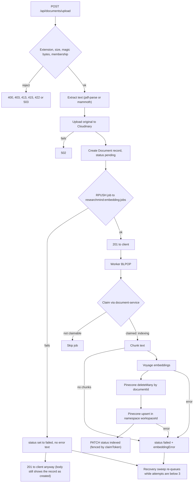
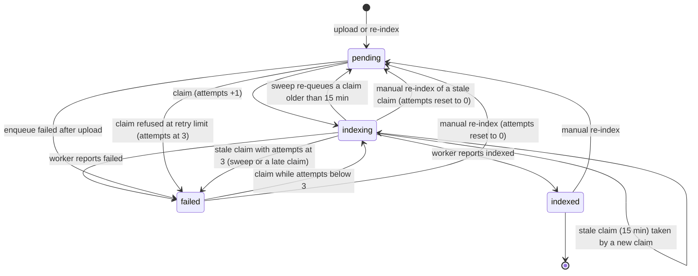

# Documents and AI — ResearchMind

This page follows a document from upload to an indexed, searchable state. It then covers retrieval, answer generation over Server-Sent Events, citations, session history and the meeting summariser. Statements are taken from the code and file paths are given.

> **Not tested against live providers.** Voyage AI, Pinecone, Groq/xAI and Cloudinary were **not** exercised against real accounts. The automated tests use fakes for them. Wherever this page describes a provider call, it describes what the code requests, not behaviour that was observed. Items that especially need checking against a live account are marked **(unverified)**.

See also: [system-architecture.md](system-architecture.md), [security.md](security.md), [../operations/background-jobs.md](../operations/background-jobs.md).

---

## 1. Supported documents

| Type | Accepted when | Text extraction | Cloudinary resource type |
|---|---|---|---|
| PDF | Extension `.pdf`, and `%PDF-` appears in the first 1024 bytes | `pdf-parse` (`PDFParse.getText()`), trimmed | `image` |
| DOCX | Extension `.docx`, and the file starts with `PK\x03\x04` | `mammoth.extractRawText`, trimmed | `raw` |

Not supported: legacy `.doc`, text files, images, and OCR (a scanned PDF yields no text). The maximum size is 10 MB. Status codes for rejected uploads are listed in [security.md](security.md#upload-validation).

---

## 2. Pipeline overview



### 2.1 Upload (document-service)

`uploadDocument` in `services/document-service/src/services/document.service.ts`:

1. multer saves the file to `uploads/<timestamp>-<original name>`. The extension filter and the 10 MB limit are applied here.
2. `workspaceId` (a form field) is required. The caller must be a member of that workspace (shared membership check; `400`/`403`/`503`). The temporary file is deleted on every rejection.
3. The file's magic bytes are checked, then the text is extracted.
4. The original file is uploaded to Cloudinary (folder `researchmind/documents`, `public_id` = the temporary file name without its extension). If that fails, the answer is `502`.
5. A `Document` record is created. `uploadedBy` comes from the JWT; storage fields, `extractedText` and `embeddingStatus: "pending"` are set by the server.
6. The embedding job is pushed with `RPUSH` (section 2.3). If the push fails, the document is set to `failed`. No `embeddingError` is recorded on this path, so the UI shows a failure without a reason. The recovery sweep retries it later.
7. The temporary file is removed and the client gets `201` with the document (including `extractedText`).

`POST /api/documents` (metadata only, not used by the frontend) creates a `pending` record with no file and empty text. It is not queued by the request. The recovery sweep queues it about 10 minutes later. The worker then fails it with "Document contains no usable text", and this repeats until all 3 attempts are used. This is how the code behaves, not an intended feature.

### 2.2 The Document record

`services/document-service/src/models/Document.ts`:

| Field | Meaning |
|---|---|
| `workspaceId`, `uploadedBy`, `originalName`, `fileType`, `fileSize` | Metadata. `uploadedBy` comes from the JWT. |
| `cloudinaryUrl`, `cloudinaryPublicId` | Storage location (server-owned) |
| `extractedText` | Full text. Left out of the list endpoint and returned by `GET /:id`. |
| `embeddingStatus` | `pending` / `indexing` / `indexed` / `failed` |
| `embeddingAttempts` | Number of claims made. A manual re-index resets it to 0. |
| `claimSequence` | Fencing token, incremented on every claim and never reset |
| `indexingStartedAt` | Time of the current claim |
| `embeddingError` | Failure reason (at most 500 characters stored; the worker sends at most 300) |
| `deletedAt` | Soft-delete marker. When set, the record is hidden from reads and cannot be claimed or marked indexed. |

### 2.3 Queue and job payload

Queue: the Redis list `researchmind:embedding:jobs` (`services/document-service/src/queues/embedding.queue.ts`). Each job is a JSON string:

```json
{ "documentId": "...", "workspaceId": "...", "uploadedBy": "...", "extractedText": "<full text>", "fileType": "pdf" }
```

The job carries the **whole extracted text**. Jobs are created on upload, on manual re-index and by the recovery sweep. How jobs are delivered, claimed, retried and recovered is covered in [background-jobs.md](../operations/background-jobs.md).

### 2.4 Worker processing (ai-service)

`processEmbeddingJob` in `services/ai-service/src/workers/embedding.worker.ts`:

1. **Claim.** `POST /internal/documents/:id/embedding/claim`.
   - Not claimable (`in-progress`, `already-indexed`, `retry-limit`, `deleted`, `not-found`): the job is skipped.
   - A claim response with no `claimToken` or no `workspaceId` is treated as an error, and the document is not processed.
2. **Workspace check.** The claimed document's `workspaceId` must equal the job's. Otherwise the document is marked `failed` ("Embedding job did not match the document's workspace") and the job is skipped.
3. **Chunk.** `chunkText()` (`services/chunking.service.ts`):
   - Normalises line endings and form feeds, removes `-- N of M --` page markers, and collapses whitespace.
   - Splits with LangChain `RecursiveCharacterTextSplitter`: `chunkSize` 400 and `chunkOverlap` 60, measured in *estimated* tokens (`ceil(characters / 4)`), with separators `\n\n`, `\n`, `. `, `! `, `? `, space, and the empty string.
   - Empty chunks are dropped. If there are no chunks at all, the job fails with "Document contains no usable text".
4. **Embed.** `generateEmbeddings()` (`services/embedding.service.ts`):
   - Batches of 20 chunks, each through `VoyageEmbeddings.embedDocuments` (`inputType: "document"`, `outputDimension: VOYAGE_EMBEDDING_DIMENSION`; the SDK client is configured with `batchSize: 8`).
   - On a rate limit (status 429, a message containing "429", or `RateLimitQuotaExhaustedError`) it waits 20 s, then 40 s; there are at most 3 attempts per batch.
   - Every vector's length must equal the configured dimension. **(unverified against Voyage)**
5. **Replace vectors.** `deleteDocumentEmbeddings(workspaceId, documentId)` runs `deleteMany({ documentId: { $eq } })` in namespace `workspaceId`; a 404 from Pinecone is ignored. Then `upsertDocumentEmbeddings` upserts in batches of 100. **(unverified: whether the configured Pinecone index supports deleting by metadata filter was not checked against a live account)**
   - Namespace: `workspaceId`
   - Vector id: `<documentId>-chunk-<chunkIndex>`. Ids are deterministic, so a retry overwrites rather than duplicates.
   - Metadata: `documentId`, `workspaceId`, `uploadedBy`, `fileType`, `chunkIndex`, `text` (the chunk text), `embeddingModel` (`VOYAGE_MODEL`).
6. **Report.** `PATCH /internal/documents/:id/embedding-status` with `{ status: "indexed", claimToken }`. Network errors and `5xx` responses are retried twice more (1 s, then 2 s).
   - `404`/`410` (deleted meanwhile): the worker deletes the vectors it just wrote.
   - `409` (claim superseded): the result is discarded.
7. **On error.** The worker reports `{ status: "failed", error: <message, at most 300 characters>, claimToken }` and rethrows. The worker loop logs the error and continues.

### 2.5 Status states



| State | Set by | `embeddingError` |
|---|---|---|
| `pending` | Upload, re-index, or the sweep re-queuing an abandoned claim | `null` after a re-index |
| `indexing` | Successful claim | Cleared to `null` |
| `indexed` | Worker report | Cleared to `null` |
| `failed` | Worker report (with reason); enqueue failure (no reason); workspace mismatch; retry limit reached ("Indexing failed after 3 attempts") | Reason or `null` |

`failed` is not final while attempts remain: the recovery sweep re-queues it. The frontend polls the document list every 5 s while anything is `pending` or `indexing` (`frontend/src/utils/document-status.ts`). It offers "re-index" for `failed` documents and for documents that look stalled (no progress for more than 15 minutes).

### 2.6 Retries (summary)

| Setting | Value | Where |
|---|---|---|
| Maximum attempts per document | 3 (`MAX_EMBEDDING_ATTEMPTS`). Every claim counts, including one whose worker crashed. | `document.service.ts` |
| Recovery sweep interval | At startup, then every 5 minutes, never overlapping | `services/document-service/src/server.ts` |
| Stale claim (worker presumed dead) | 15 minutes (`STALE_INDEXING_MS`) | `document.service.ts` |
| `pending`/`failed` re-queued after no update for | 10 minutes (`STALE_PENDING_MS`) | `document.service.ts` |
| Sweep skips re-queueing when the queue holds | 100 or more jobs (`MAX_RECOVERY_BACKLOG`) | `document.service.ts` |
| Fencing | `claimSequence` returned as `claimToken`; status updates apply only if the document is still `indexing` with the same sequence | `document.controller.ts` |
| Manual re-index | `POST /api/documents/:id/reindex`. Resets attempts and error and sets status `pending`. Refused with `409` while a live (under 15 min) claim exists. Answers `503` if the queue push fails. | `reindexDocument` |

### 2.7 Deletion

`DELETE /api/documents/:id`, handled by `deleteDocument`:

1. Load the document and check that the caller is a member of the document's stored workspace.
2. Atomically set `deletedAt`. The document is now hidden from reads, cannot be claimed, and cannot be marked indexed. If two deletes race, the second gets `404`.
3. Ask ai-service to delete the vectors: `DELETE /internal/vectors/workspaces/:workspaceId/documents/:documentId` (`X-Internal-Token`, 15 s timeout). The ids come from the stored record. ai-service checks that both are ObjectIds and runs `deleteMany` filtered on `documentId` in that namespace.
4. **If vector deletion fails**, `deletedAt` is cleared (rollback) and the client gets `503` "could not be removed from the search index". The document stays visible.
5. Destroy the Cloudinary asset, unless **another record shares the same `cloudinaryPublicId`** (guard). A failure here is logged and does not block the deletion. Then delete the record.
6. If the process stops after step 2, the recovery sweep finishes deletions older than 5 minutes (`STALE_DELETION_MS`) by repeating steps 3 and 5.

A worker that was mid-job when the document was deleted receives `404`/`410` on its status report and removes its vectors (see [background-jobs.md](../operations/background-jobs.md#deletion-during-processing)).

---

## 3. Retrieval

`POST /api/ai/search` (raw chunks, JSON) and `POST /api/ai/query` (SSE) both use `semanticSearch()` (`services/ai-service/src/services/query.service.ts`):

- Body validation (`packages/validation/schemas/ai.schema.ts`): `workspaceId` must be a 24-hex id; `query` is trimmed and must be 1–2000 characters; `topK` is an integer 1–10, default 5. The service also clamps `topK` to 1–10.
- Then the membership check (`400`/`403`/`503`).
- The query is embedded with `voyageQueryEmbeddings.embedQuery` (`inputType: "query"`, same model and dimension). The dimension is checked. On 429 there are up to 3 attempts, waiting 15 s and then 30 s.
- Pinecone `query` runs in namespace `workspaceId` with `topK` and `includeMetadata: true`. Matches without a score or without metadata are dropped. Each result has `documentId`, `workspaceId`, `chunkIndex`, `text`, `score` and `fileType` from the metadata.
- **There is no score threshold, no re-ranking, and no filter on `embeddingModel`.**

---

## 4. Answer generation and SSE (`POST /api/ai/query`)

`queryStreamHandler` (`controllers/query.controller.ts`) and `runRagStreamQuery` (`services/rag.service.ts`):

Validation and membership failures return ordinary JSON errors (`400`/`401`/`403`/`503`) *before* the stream starts. After that the response headers are `Content-Type: text/event-stream`, `Cache-Control: no-cache, no-transform`, `Connection: keep-alive` and `X-Accel-Buffering: no`. Each event is written as `event: <name>\ndata: <json>\n\n`.

| Event | Data | When |
|---|---|---|
| `start` | `{ query }` | Immediately |
| `sources` | `{ sources: [{ documentId, chunkIndex, score, fileType }] }` | After retrieval. May be an empty array. |
| `token` | `{ text }` | Once per streamed text delta |
| `done` | `{ sessionId, unverifiedCitations: number[] }` | After a complete answer has been saved. `sessionId` is `null` if saving failed. |
| `error` | `{ message, partial }` | Instead of `done` |

Possible event sequences:

- **Success:** `start` → `sources` → `token`* → `done`
- **Retrieval failure:** `start` → `error` ("Could not search this workspace's documents right now.", `partial: false`). Generation is never attempted without context.
- **LLM failure:** `start` → `sources` → `token`* → `error`. `partial: true` means tokens were already sent before the failure. Nothing is saved and no `done` is sent.
- **Unexpected exception:** `error` with the fixed message "AI service is temporarily unavailable. Please try again."

The client (`frontend/src/utils/ai-stream.ts`) treats only `done` as a complete answer. It ignores anything after a terminal event. A stream that closes with no terminal event is shown as incomplete.

### Prompt and model call

- Context (`services/context.service.ts`) is built from each retrieved chunk as:

  ```text
  [Source N]
  Document ID
  Chunk Index
  File Type
  Relevance Score
  <chunk text>
  ```

  Blocks are separated by `---`. With no matches, the context is "No relevant document chunks found in this workspace."
- The system prompt (`prompts/rag.prompt.ts`) tells the model to answer only from the context, to say when the context is insufficient, to use Markdown and LaTeX, and to cite with `[Source N]`.
- The model is called with `grokClient.chat.completions.create({ model: XAI_MODEL, temperature: 0.2, max_tokens: 1500, stream: true })` (`services/grok.service.ts`).

### Timeouts

| Setting | Default | Effect |
|---|---|---|
| `LLM_REQUEST_TIMEOUT_MS` | 60 000 | SDK `timeout` for opening the request. Also the overall timeout for the non-streaming meeting summary. |
| `LLM_STREAM_IDLE_TIMEOUT_MS` | 30 000 | Watchdog armed before the request and re-armed on every token. When it fires, the stream is aborted, the reason is recorded as `timeout`, and an `error` event is sent. It also limits the time to the first token. |

Neither value is validated. A non-numeric value becomes `NaN` (see [security.md](security.md#known-limitations-and-unresolved-risks)). An empty answer (only whitespace) is treated as a failure.

### Citations

`auditAnswerCitations()` (`services/citation-validator.service.ts`) finds every `[Source N]` marker in the finished answer. `unverifiedCitations` lists the numbers that are outside `1..retrievedCount`; with zero sources, every marker is unverified. The answer itself is **not modified**: unverified markers are logged and reported to the client, which shows a notice. Source objects always come from Pinecone metadata and are never generated by the model. Whether a *valid* marker actually supports the sentence it is attached to is **not** checked.

### Client disconnects

If the user stops the answer (`AbortController` in `frontend/src/hooks/useAiQuery.ts`) or closes the tab, generation continues to the end and the session is still saved: there is no disconnect handling in the controller (`query.controller.ts` registers no `close` handler). This comes from reading the code; it was not exercised against a live provider.

During shutdown, open streams get the 5 s server grace period and are then closed. The gateway ends the client response when the upstream response closes before completing.

---

## 5. Session history

- Each completed answer is saved as an `AISession` (`services/ai-service/src/models/AISession.ts`) with `workspaceId`, `userId`, `query`, `answer`, `sources` (`documentId`, `chunkIndex`, `score`; `fileType` is not in the schema and is dropped), `aiModel` and timestamps. A failed save is logged and `done.sessionId` is `null`.
- `GET /api/ai/sessions/workspace/:workspaceId` returns the **20 most recent sessions for the whole workspace**, from every member (newest first), after the membership check.
- There is no conversational memory. `ragQuerySchema` accepts an optional `sessionId` (up to 100 characters), but nothing uses it. Each question is answered on its own.
- Session records are never deleted, including when the documents they cite are deleted.

---

## 6. Meeting summariser (`POST /api/ai/summarize-meeting`)

`services/ai-service/src/services/meeting-summarizer.service.ts`:

- Input: `workspaceId` (membership is checked by `requireWorkspaceMembership`) and `text` (trimmed, 10–50 000 characters). Rate limit: 20 per hour per user at the gateway.
- One non-streaming call with `temperature: 0.2`, `max_tokens: 4096` (`MEETING_SUMMARY_MAX_TOKENS`), and `timeout: LLM_REQUEST_TIMEOUT_MS`. The system prompt requires JSON only, with exactly these keys:
  - `meeting_date`
  - `attendees`
  - `summary`
  - `decisions`
  - `action_items[{task, assignee, due}]`
  - `open_questions`
  - `next_meeting`

  It also tells the model not to invent facts and to write due dates as `YYYY-MM-DD` only when the notes give a specific calendar date.
- Output handling:
  1. `finish_reason: "length"` (truncated) is rejected.
  2. Markdown code fences are stripped.
  3. The text is parsed with `JSON.parse`.
  4. It is validated with `meetingSummarySchema`: `null` becomes `""` or `[]`, strings are trimmed, empty list items and action items without a task are dropped, and unknown keys are removed. A wrong type (for example an object where text is expected) is rejected.
- Any failure becomes `502` with the fixed LLM-unavailable message. Model output is never returned in an error.
- The summary is **not stored**.
- **Turning action items into tasks** (frontend, `frontend/src/utils/meeting-tasks.ts`). The selected items are sent to `POST /api/tasks/workspaces/:id/tasks/bulk`, which accepts at most 50 items and uses an `importKey` built from the summary, the board and the selection so that resubmitting creates nothing new. For each task:
  - `dueDate` is set only when `due` is an exact, valid `YYYY-MM-DD`, converted to ISO midnight UTC. Other due text is kept in the description as "Due (from meeting notes): …".
  - Assignee names are never mapped to user ids: `assigneeId` is `null`, and the name goes into the description.

  The bulk import is all-or-nothing through a **compensating rollback, not a transaction** (MongoDB transactions need a replica set, which the deployment does not have). If a write fails, `compensate` in `services/task-service/src/services/task.service.ts` deletes the tasks and activities already written. If that cleanup itself fails, the partial import is left in place and only logged (`Bulk import rollback failed for tasks <ids>`).

---

## 7. What is unverified

| Item | Why it matters |
|---|---|
| Voyage `voyage-3` with `outputDimension` 1024, and the SDK's 429 error shapes | Dimension checks and backoff rely on them |
| Pinecone `deleteMany` by metadata filter on the configured index type | Document deletion and re-indexing rely on it. A 404 is ignored. |
| Pinecone startup check (`listIndexes`) | If Pinecone is unreachable at startup, the service logs a warning and starts anyway |
| Default LLM model ids (`openai/gpt-oss-120b` on Groq, `grok-4.5` on xAI) and streaming deltas in OpenAI format | Not checked at startup. A wrong id only shows up as `error` events at query time. |
| Cloudinary `image` delivery for PDFs and `raw` for DOCX, and `destroy` with the matching resource type | Viewing and deleting files rely on them |
| Answer quality, citation faithfulness and prompt-injection resistance | Not evaluated |
