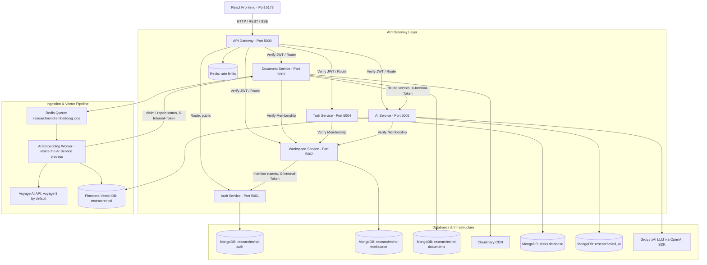

# System Architecture — ResearchMind

## Overview

ResearchMind is an AI-powered research workspace for engineering student teams. The system uses a microservices architecture with isolated data stores, an API Gateway, JWT authentication, specialized domain microservices, and an AI Service powered by Voyage AI, Pinecone, xAI / Groq LLM, Server-Sent Events (SSE), and MongoDB.

---

## High-Level Architecture Diagram

---

## Active Microservices & Ports

| Service Name | Port | Database / Storage | Responsibilities |
|--------------|------|--------------------|------------------|
| **Frontend Client** | `5173` | Local Storage / Zustand | React SPA with Vite, Tailwind CSS, Lucide Icons, and `react-pdf` in-app viewer |
| **API Gateway** | `5000` | Redis (Rate Limiting) | Request routing, JWT access token verification (all routes except `/api/auth`), Redis-backed rate limiting (`express-rate-limit`, fails open if Redis is down), Swagger UI (`/api-docs`). It does **not** check workspace membership. |
| **Auth Service** | `5001` | MongoDB (`researchmind-auth`); Redis connected but unused | User registration, login, bcrypt password hashing, JWT access/refresh token signing, refresh-token rotation with reuse detection, logout, internal user lookup for workspace-service |
| **Workspace Service** | `5002` | MongoDB (`researchmind-workspace`) | Workspace creation, invite code generation and join, member list, membership check API (`GET /api/workspaces/:workspaceId/membership`). No roles; invite codes do not expire. |
| **Document Service** | `5003` | MongoDB (`researchmind-documents`), Cloudinary, Redis Queue | Multer document upload (PDF/DOCX only, 10 MB), file-signature check, text extraction (`pdf-parse`/`mammoth`), Cloudinary storage, `uploadedBy` from the JWT, Redis embedding queue producer, embedding status and retries, recovery sweep, delete (vectors first) and re-index |
| **Task Service** | `5004` | MongoDB | Boards, tasks, subtasks, task activity log, all-or-nothing idempotent bulk creation (max 50, optional `importKey`), assignee must be a workspace member |
| **AI Service** | `5006` | MongoDB (`researchmind_ai`), Pinecone, Redis Queue | In-process Redis embedding worker, chunking (LangChain `RecursiveCharacterTextSplitter`, ~400 estimated tokens / 60 overlap), Voyage AI embeddings (`VOYAGE_MODEL`, default `voyage-3`, 1024 dims), Pinecone vector upsert/search/delete (`namespace: workspaceId`), RAG context builder, Groq/xAI LLM (OpenAI SDK) streaming via Server-Sent Events (`POST /api/ai/query`), session history, meeting summarizer, and MongoDB `AISession` logging |
| **Notification Service** | — | — | Not implemented (empty placeholder) |

### Workspace membership checks
The gateway only verifies the JWT. Each workspace-scoped service (document, task, ai) verifies the JWT again and asks workspace-service whether the caller is a member, forwarding the caller's own bearer token (`packages/shared/auth/workspace-membership.ts`, 3 s timeout):
- malformed workspace id → `400`
- not a member → `403`
- the check could not run (timeout, network error, workspace-service error) → `503`

### Service-to-service calls
Internal routes (`/internal/...` on document-, ai- and auth-service) require the shared `INTERNAL_SERVICE_TOKEN` in the `X-Internal-Token` header and are not exposed through the gateway.

---

## Core Flows

### 1. Authentication & Workspace Onboarding Flow
1. User registers/logs in via Frontend $\rightarrow$ `POST /api/auth/register` or `POST /api/auth/login` (Gateway `:5000` $\rightarrow$ Auth Service `:5001`).
2. Auth Service returns the user profile, a signed JWT access token (default 15 min) and a refresh token (default 7 days). Only a SHA-256 hash of the refresh token is stored, in MongoDB. The client keeps both tokens in `localStorage` (persisted Zustand store).
3. On a `401` the client calls `POST /api/auth/refresh` with the refresh token in the JSON body. Every refresh rotates the pair. Presenting an already-rotated token revokes all of that user's sessions, except within `REFRESH_REUSE_GRACE_MS` (default 10 s), where a concurrent refresh (e.g. a second tab) is rejected without revoking anything.
4. User creates or joins a workspace via `POST /api/workspaces` or `POST /api/workspaces/join` (Gateway `:5000` $\rightarrow$ Workspace Service `:5002`). Invite codes are matched case-insensitively; an unknown code answers `404`, an existing member gets `409`.
5. Active workspace is stored in Zustand state and persisted across navigation.

Not implemented: password reset, Google sign-in, email invites, member roles.

### 2. Document Ingestion & Viewing Flow
1. User uploads PDF or DOCX file via `POST /api/documents/upload` with `multipart/form-data`.
2. API Gateway validates JWT access token and forwards request to Document Service (`:5003`).
3. Document Service verifies workspace membership via Workspace Service (`:5002`).
4. `uploadedBy` is set strictly to the authenticated `userId` from the JWT token.
5. Only `.pdf` and `.docx` up to 10 MB are accepted; the file's bytes must match its extension. Wrong type → `415`, empty or unreadable file → `422`, too large → `413`. Text is extracted from PDF (`pdf-parse`) or DOCX (`mammoth`).
6. Original file is uploaded to Cloudinary (`image` asset type for PDFs; `raw` for DOCX).
7. Document metadata is persisted in MongoDB collection `documents` in `researchmind-documents`.
8. Embedding job payload is pushed to Redis list `researchmind:embedding:jobs` (status `pending`; if the push fails the status becomes `failed`).
9. In-app PDF Viewer (`react-pdf`) renders the document directly inside ResearchMind upon clicking any PDF card.

### 3. Asynchronous Embedding & Vector Indexing Flow
1. The embedding worker inside the AI Service (`:5006`) pops a job from Redis queue `researchmind:embedding:jobs`.
2. It claims the document from Document Service (`POST /internal/documents/:id/embedding/claim`), which moves it to `indexing`. Duplicate jobs, deleted documents and documents with no attempts left are not claimed.
3. Extracted text is split into overlapping chunks (~400 estimated tokens, 60 overlap).
4. Embeddings are generated with Voyage AI (`VOYAGE_MODEL`, default `voyage-3`, 1024 dimensions by default).
5. Vectors and metadata (`documentId`, `workspaceId`, `uploadedBy`, `chunkIndex`, `text`, `fileType`, `embeddingModel`) are upserted to the Pinecone index (`PINECONE_INDEX`) isolated by `namespace = workspaceId`.
6. The worker reports `indexed`, or `failed` with a reason, to Document Service (`PATCH /internal/documents/:id/embedding-status`).
7. A document is tried at most 3 times. Every 5 minutes, a recovery sweep in Document Service re-queues documents left `pending`, stuck in `indexing`, or `failed` with attempts remaining. `POST /api/documents/:id/reindex` starts a fresh retry budget.

### Document Deletion Flow
1. `DELETE /api/documents/:id` marks the document as deleting (hidden from reads).
2. Document Service asks AI Service to delete the document's vectors (`DELETE /internal/vectors/workspaces/:workspaceId/documents/:documentId`).
3. If that fails, the deletion is rolled back and the request answers `503`; the document stays visible.
4. Otherwise the Cloudinary asset and the MongoDB record are removed.

### 4. RAG Query & Token Streaming Flow (`POST /api/ai/query`)
1. User submits search query via Frontend or HTTP client to `POST /api/ai/query`.
2. API Gateway verifies JWT token and forwards to AI Service (`:5006`).
3. The body is validated: the query is trimmed and must be 1–2000 characters; `topK` is 1–10 (default 5).
4. AI Service validates workspace membership via Workspace Service (`:5002`).
5. Search query is vectorized into a 1024-dim embedding via Voyage AI (same model as indexing).
6. Pinecone searches top-K vector chunks in namespace `workspaceId`.
7. RAG Context Builder constructs structured context with `[Source N]` citations.
8. The Groq / xAI LLM (OpenAI SDK) streams response tokens over HTTP Server-Sent Events (`Content-Type: text/event-stream`).
9. Event sequence: `start` $\rightarrow$ `sources` (citation array) $\rightarrow$ `token` (streamed text deltas) $\rightarrow$ `done` (`sessionId`, `unverifiedCitations`). If generation fails, an `error` event (`message`, `partial`) is sent instead of `done`.
10. Full Q&A interaction, citations, user ID, workspace ID, and model metadata are logged to MongoDB collection `aisessions` in `researchmind_ai`. Past sessions are listed via `GET /api/ai/sessions/workspace/:workspaceId`.

Other AI endpoints: `POST /api/ai/search` returns raw retrieval results (not streamed); `POST /api/ai/summarize-meeting` returns a structured JSON summary (not streamed, not stored).

### 5. Task Flow
1. Boards and tasks live under `/api/tasks/workspaces/:workspaceId/...` (Gateway `:5000` $\rightarrow$ Task Service `:5004`); every request is checked for workspace membership.
2. An assignee must be the user id of a workspace member; otherwise `400`.
3. The Meeting Summarizer page creates tasks from action items with `POST /api/tasks/workspaces/:workspaceId/tasks/bulk`: at most 50 tasks, all-or-nothing, and idempotent when the optional `importKey` is repeated.
