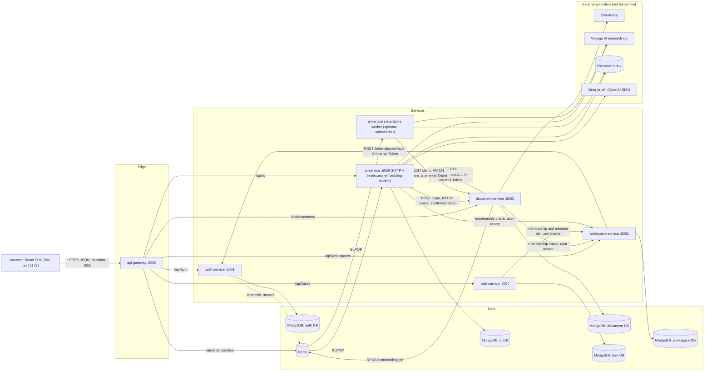
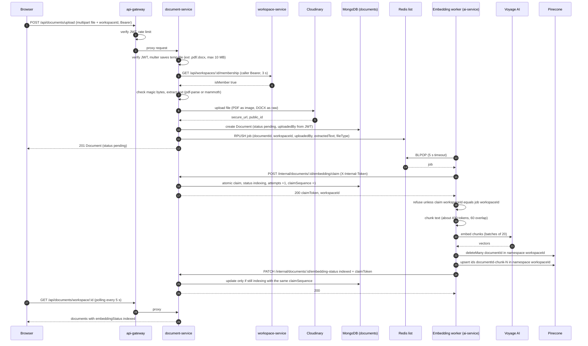
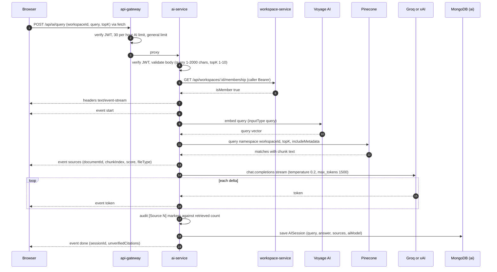
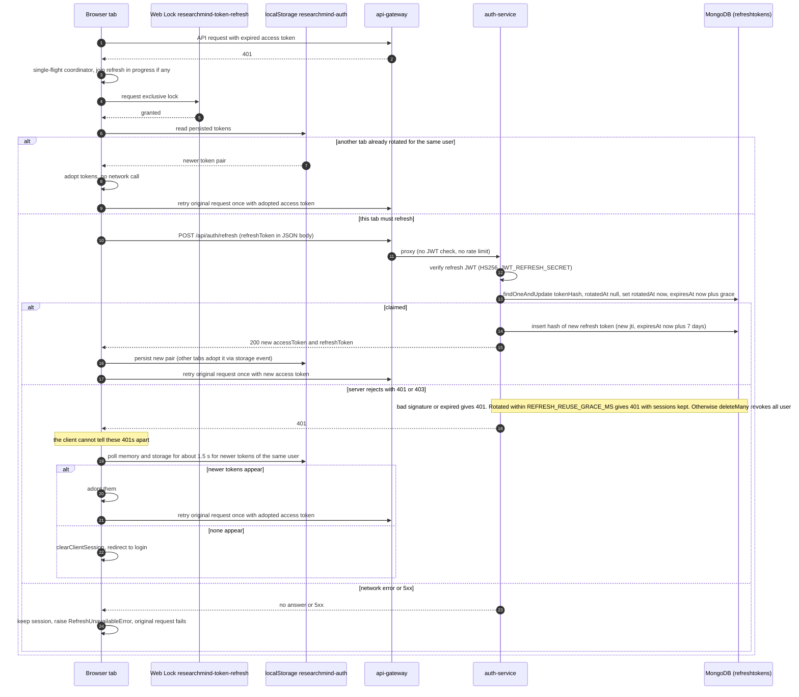

# System Architecture — ResearchMind

ResearchMind is a research workspace for student teams. Members upload PDF/DOCX documents, ask questions answered from those documents, summarise meeting notes and manage tasks. The backend is a set of Node.js/Express (TypeScript) services behind an API gateway. Each service has its own MongoDB database. Redis is used for rate limiting and for the embedding job queue. Voyage AI provides embeddings, Pinecone stores vectors, and Groq or xAI provides the LLM through the OpenAI SDK.

This page describes what the code does today. Every statement was checked against the source; file paths are given so you can check them again. Related pages:

- [security.md](security.md): authentication, authorization and known risks
- [documents-and-ai.md](documents-and-ai.md): the document pipeline, retrieval and answer generation
- [../operations/background-jobs.md](../operations/background-jobs.md): the embedding worker, retries and recovery

> **External providers were not tested against live accounts.** Voyage AI, Pinecone, Groq/xAI and Cloudinary are called through their SDKs, but the automated tests (`tests/`) replace them with fakes. Wherever this page describes provider behaviour, it means what the code *asks* the provider to do. The provider's actual behaviour has not been verified.

---

## 1. What exists

| Area | Status | Where |
|---|---|---|
| API gateway (proxy, JWT check, Redis rate limits, Swagger UI) | Implemented | `services/api-gateway` |
| Auth: register, login, refresh rotation with reuse detection, logout, `/me` | Implemented | `services/auth-service` |
| Workspaces: create, list, join by invite code, membership check, member list | Implemented | `services/workspace-service` |
| Documents: PDF/DOCX upload, text extraction, Cloudinary storage, embedding status, re-index, delete | Implemented | `services/document-service` |
| Tasks: boards, tasks, subtasks, activity log, bulk import | Implemented | `services/task-service` |
| AI: embedding worker, semantic search, streamed RAG answers (SSE), session history, meeting summariser | Implemented (providers not tested live) | `services/ai-service` |
| Frontend SPA | Implemented; 5 sidebar routes are placeholders (section 9) | `frontend/` |
| Workspace roles, removing members, rotating or expiring invite codes | Not implemented | — |
| Password reset, email verification, OAuth sign-in | Not implemented | — |
| Notification service | Not implemented: `src/app.ts` and `src/server.ts` are empty, and there are no `dev`/`start` scripts | `services/notification-service` |
| Container images for the services | Not implemented: `docker-compose.yml` only runs MongoDB, Redis and mongo-express | `docker-compose.yml` |

---

## 2. Component view

Browser-side connections that do not go through the gateway:

- PDFs are fetched directly from Cloudinary using the stored `cloudinaryUrl`, for the in-app viewer and for "open in new tab".
- The PDF.js worker script is loaded from `unpkg.com` (`frontend/src/components/documents/PdfViewerModal.tsx`).

---

## 3. Services and responsibilities

| Service | Port (default) | Database (connection variable) | Redis | Responsibilities |
|---|---|---|---|---|
| api-gateway | 5000 | none | Rate-limit store (`REDIS_URL`) | Proxies 5 path prefixes. Verifies the access token on every prefix except `/api/auth`. Applies rate limits and serves Swagger UI at `/api-docs`. Does **not** check workspace membership. |
| auth-service | 5001 | `MONGO_URI` (users, refresh tokens) | Connects with `REDIS_HOST`/`REDIS_PORT` in the background but **no code path uses it** (`src/server.ts`, `src/config/redis.ts`) | Register, login, refresh rotation, logout, `/me`. Also serves internal `POST /internal/users/bulk` for workspace-service. |
| workspace-service | 5002 | `MONGO_URI` (workspaces) | none | Create, list, join by invite code, membership check, detail, member list. Member names come from auth-service. |
| document-service | 5003 | `MONGODB_URI` or `MONGO_URI` (documents) | Queue producer (`RPUSH`, `LLEN`) | Upload validation, text extraction (`pdf-parse`, `mammoth`), Cloudinary upload, document records, embedding status and claims, recovery sweep, delete, re-index. |
| task-service | 5004 | `MONGODB_URI` or `MONGO_URI` (boards, tasks, activity) | none | Boards, tasks, subtasks, activity log, bulk create (max 50, optional `importKey`). Checks that the assignee is a workspace member. |
| ai-service (HTTP) | 5006 | `MONGODB_URI` or `MONGO_URI` (AI sessions) | General client for `/health`. Worker client (`BLPOP`) for the in-process worker. | Semantic search, SSE RAG answers, session history, meeting summary. Serves internal vector deletion. Runs the embedding worker in-process. |
| ai-service (standalone worker) | — | none | Worker client (`BLPOP`) | Optional second consumer of the same queue (`src/worker.ts`). Does not connect to MongoDB. |
| notification-service | — | — | — | Empty placeholder |

Database names are not set in code. They come from the connection URI. The `.env.example` files use `researchmind-auth`, `researchmind-workspace`, `researchmind-document`, `researchmind-task` and `researchmind-ai`. No service reads another service's database. Data owned by another service is always read over HTTP.

---

## 4. Request flow through the gateway

The browser sends every API call to the gateway (`VITE_API_URL`, default `http://localhost:5000/api`). `services/api-gateway/src/app.ts` mounts global middleware first (`cors()`, `helmet`, `morgan`), then Swagger UI at `/api-docs`, then the routes below in this order, and `/health` last:

| Path prefix | Gateway middleware before proxying | Target (env var, default) |
|---|---|---|
| `/api-docs` (mounted first) | Swagger UI. No authentication. | — |
| `POST /api/auth/login` | Login limiter: 5 failed attempts per 15 min per IP | — |
| `POST /api/auth/register` | Register limiter: 3 per hour per IP | — |
| `/api/auth/*` | No JWT check and no other limiter (refresh, `/me` and logout are not rate-limited) | `AUTH_SERVICE_URL`, `http://localhost:5001` |
| `/api/workspaces/*` | `authenticate`, then general limiter (100/min per user) | `WORKSPACE_SERVICE_URL`, `:5002` |
| `/api/documents/*` | `authenticate`, then general limiter | `DOCUMENT_SERVICE_URL`, `:5003` |
| `/api/tasks/*` | `authenticate`, then general limiter | `TASK_SERVICE_URL`, `:5004` |
| `/api/ai/*` | `authenticate`. `query` and `search` share a limit of 30/hour per user. `summarize-meeting` has its own 20/hour per user. Then the general limiter. | `AI_SERVICE_URL`, `:5006` |
| `/health` (mounted last) | Static `{ success: true }`. No dependency checks. | — |

Points to note:

- **The gateway does not forward its verification result.** It verifies the JWT (HS256, `JWT_ACCESS_SECRET`) and passes the original `Authorization` header unchanged. Each service verifies the token again: `packages/shared/auth/authenticate.ts`, `services/auth-service/src/middlewares/auth.middleware.ts`, and `services/workspace-service/src/middlewares/auth.middleware.ts`.
- **`/internal/*` is never proxied.** The gateway only matches the five `/api/...` prefixes, and every internal router is mounted at `/internal` on its service. Internal routes can only be reached on a service's own port, and they require `X-Internal-Token`. The services call `app.listen(PORT)` with no host, so they listen on all interfaces. Restricting network access is left to the deployment; the repository does not do it.
- **Proxy errors.** If a target cannot be reached, the gateway answers `503 { success:false, message:"Service temporarily unavailable..." }`. If ai-service dies part-way through a streamed answer, the gateway ends the client response. The client then sees a stream with no terminal event and reports the answer as incomplete (`endClientResponseIfUpstreamAborts`).
- **Workspace authorization happens in the services.** document-, task- and ai-service ask workspace-service whether the caller belongs to the workspace (`packages/shared/auth/workspace-membership.ts`). They pass the caller's own bearer token and allow 3 s. Possible results: `400` (malformed id), `403` (not a member), `503` (the check could not complete). See [security.md](security.md#workspace-authorization).

### Service-to-service calls

| Caller → callee | Route | Authentication | Timeout | On failure |
|---|---|---|---|---|
| document/task/ai → workspace | `GET /api/workspaces/:id/membership` | Caller's bearer token | 3 s | `503` to the client |
| task → workspace | `GET /api/workspaces/:id` (member ids, used for assignee checks) | Caller's bearer token | 3 s | `503`; `403` if not a member |
| workspace → auth | `POST /internal/users/bulk` | `X-Internal-Token` (skipped entirely if the token is unset) | none set | Members are still returned, with name `"Researcher"` and an empty email |
| ai worker → document | `POST /internal/documents/:id/embedding/claim`, `PATCH /internal/documents/:id/embedding-status` | `X-Internal-Token` | 15 s | See [background-jobs.md](../operations/background-jobs.md) |
| document → ai | `DELETE /internal/vectors/workspaces/:workspaceId/documents/:documentId` | `X-Internal-Token` | 15 s | Deletion rolled back, `503` to the client |

---

## 5. Redis usage

| Client | Library | Purpose | Behaviour when Redis is down |
|---|---|---|---|
| api-gateway `limiterRedis` | ioredis via `rate-limit-redis` | Rate-limit counters (`rl:<name>:` prefixes) | Limiters **fail open** (`passOnStoreError: true`). The error is logged once. |
| document-service `redis` | ioredis | `RPUSH researchmind:embedding:jobs` on upload, re-index and recovery; `LLEN` for the sweep's backlog check | Reconnects forever (backoff capped at 5 s). Each command fails after `maxRetriesPerRequest: 3`. A failed upload enqueue sets the document to `failed`; a failed re-index answers `503`. `/health` returns 503. |
| ai-service `redis` | ioredis | `/health` only | `/health` returns 503 |
| ai-service `redisWorker` | ioredis, `maxRetriesPerRequest: null` | `BLPOP` with a 5 s timeout (embedding worker) | Waits and reconnects indefinitely |
| auth-service `redisClient` | node-redis | None (connects in the background, never used) | Errors are logged and startup is not blocked |

The queue is a plain Redis list. `BLPOP` removes a job from the list as soon as a worker receives it. Delivery is therefore at-most-once. What makes the pipeline reliable is that MongoDB holds each document's status durably and the recovery sweep re-queues stalled work. See [background-jobs.md](../operations/background-jobs.md).

---

## 6. External providers

| Provider | Used by | Configuration | What the code checks | Live-tested? |
|---|---|---|---|---|
| Cloudinary | document-service upload and delete | `CLOUDINARY_CLOUD_NAME`, `CLOUDINARY_API_KEY`, `CLOUDINARY_API_SECRET` | Nothing at startup. An upload failure becomes `502`. | No |
| Voyage AI | ai-service (document and query embeddings) | `VOYAGE_API_KEY` (required at import), `VOYAGE_MODEL` (default `voyage-3`), `VOYAGE_EMBEDDING_DIMENSION` (default 1024) | Each embedding's dimension is checked at runtime | No |
| Pinecone | ai-service (upsert, query, delete by metadata filter) | `PINECONE_API_KEY`, `PINECONE_INDEX` (both required at import) | At startup, the index dimension is compared with `VOYAGE_EMBEDDING_DIMENSION`. A mismatch or missing index aborts startup. If Pinecone cannot be reached, a warning is logged and startup continues. | No |
| Groq / xAI | ai-service (RAG answers, meeting summaries) | `XAI_API_KEY` or `GROQ_API_KEY` (required at import). A key starting `gsk_` selects Groq. `XAI_BASE_URL`, `XAI_MODEL` (defaults `openai/gpt-oss-120b` on Groq, `grok-4.5` on xAI). | The model name is logged at startup but **never checked** against the provider | No |

---

## 7. Startup and shutdown

All services call `dotenv.config()`. Then they call `assertRequiredSecrets()` (`packages/shared/config/secrets.ts`) before importing the app. A secret is rejected if it is missing, still an `.env.example` `<placeholder>`, a known weak value, or shorter than 32 characters. Rejection prints the variable name only and exits with code 1.

MongoDB connections go through `connectMongo()` (`packages/shared/lifecycle/mongo.ts`). It makes one attempt, bounded by the driver's server-selection timeout (Mongoose default 30 s). If that fails, the service exits with code 1. After a successful start, the driver reconnects by itself. Disconnects and reconnects are logged, and `/health` shows the live state.

| Service | Secrets checked at boot | Other startup steps | Shutdown steps (in order) |
|---|---|---|---|
| api-gateway | `JWT_ACCESS_SECRET` | none | stop HTTP → close rate-limit Redis |
| auth-service | `JWT_ACCESS_SECRET`, `JWT_REFRESH_SECRET` | MongoDB (required); Redis connect in background | stop HTTP → MongoDB → Redis |
| workspace-service | `JWT_ACCESS_SECRET` | MongoDB (required); `syncIndexes()` when `NODE_ENV !== "production"` | stop HTTP → MongoDB |
| document-service | `JWT_ACCESS_SECRET`, `INTERNAL_SERVICE_TOKEN` | MongoDB (required); recovery sweep immediately, then every 5 min | stop HTTP → clear sweep timer → MongoDB → Redis |
| task-service | `JWT_ACCESS_SECRET` | MongoDB (required); `syncIndexes()` outside production | stop HTTP → MongoDB |
| ai-service (HTTP) | `JWT_ACCESS_SECRET`, `INTERNAL_SERVICE_TOKEN` | Provider keys must be set (a missing key throws on import, so the process crashes). MongoDB (required). Models logged. Pinecone index dimension check (exits on mismatch; skipped with a warning if Pinecone is unreachable). Redis ping (warns only). Worker started. | stop HTTP → stop worker (current job may finish) → MongoDB → Redis → worker Redis. Timeout 30 s. |
| ai-service (standalone worker) | `INTERNAL_SERVICE_TOKEN` | `VOYAGE_API_KEY`, `PINECONE_API_KEY`, `PINECONE_INDEX` required at import; Pinecone index check (same rule as the HTTP service) | stop worker → worker Redis. Timeout 30 s. |

Graceful shutdown is handled by `packages/shared/lifecycle/shutdown.ts`, triggered by SIGINT or SIGTERM:

1. The HTTP server stops accepting connections. In-flight requests, including SSE streams, get `serverGraceMs`: the smaller of 5 s and half the timeout. After that, remaining connections are closed.
2. The steps run in order. Every step runs even if an earlier one failed.
3. The process exits with 0, or with 1 if any step failed or the overall timeout passed (default 10 s, 30 s for ai-service). A second signal forces `exit(1)`.

---

## 8. Health endpoints

| Service | Endpoint | Reports |
|---|---|---|
| api-gateway | `GET /health` | Always 200; no dependency checks |
| auth, workspace, task | `GET /health` | 503 unless MongoDB is connected |
| document-service | `GET /health` | 503 unless MongoDB is connected and the producer Redis client is `ready` |
| ai-service | `GET /health` | 503 unless MongoDB is connected and the general Redis client is `ready`. The worker's own Redis client is not checked. |

---

## 9. Frontend

**Stack.** React 19, React Router, React Query (`frontend/src/lib/queryClient.ts`, `retry: 1`), zustand stores persisted to `localStorage` (`researchmind-auth` and `researchmind-workspace`), and axios.

**Routing** (`frontend/src/routes/AppRouter.tsx`):

| Route | Guard | Page |
|---|---|---|
| `/login`, `/register` | Signed-out users only (`GuestOnly`) | Login and register |
| `/create-workspace` | `ProtectedRoute` | Create or join a workspace |
| `/dashboard` | `ProtectedRoute` → `OnboardingGuard` → `AppShell` | Overview |
| `/dashboard/tasks` | same | Kanban |
| `/dashboard/documents` | same | Documents (upload, list, status, PDF viewer, re-index, delete) |
| `/dashboard/ai-researcher`, `/app/workspace/:id/search` | same | Semantic search / RAG Q&A |
| `/dashboard/meeting-notes` | same | Meeting summariser and task import |
| `/dashboard/sources`, `/analytics`, `/literature-review`, `/report-drafter`, `/settings` | same | **Placeholder** ("module is currently in development") |
| `*` | — | Redirects to `/dashboard` when signed in, otherwise `/login` |

`ProtectedRoute` only checks the `isAuthenticated` flag held in the client. Every API call is still authenticated by the server. `OnboardingGuard` holds a loading screen until the workspace list has actually been fetched. If the fetch fails, it shows a retry screen with a sign-out button. Only a list that loaded successfully and is empty redirects to `/create-workspace`.

**API integration** (`frontend/src/api/`):

- `axios.ts`: one axios instance. The base URL is `VITE_API_URL` (default `http://localhost:5000/api`). Interceptors (`auth-interceptors.ts`) add `Authorization: Bearer <access token>`. On a `401` they refresh the token once through a shared coordinator (`lib/token-refresh.ts`) and retry. They never refresh for `/auth/login`, `/auth/register` or `/auth/refresh`.
- `ai.api.ts`: the RAG stream uses `fetch()` rather than axios, so it can read the response body as a stream. It gets the token from `ensureFreshToken()` and retries once after a `401`. `utils/sse.ts` and `utils/ai-stream.ts` parse the events. Only a `done` event counts as a complete answer.
- `document.api.ts`: upload is `multipart/form-data` with `file` and `workspaceId`. The documents hook polls the list every 5 s while any document is `pending` or `indexing`, every 60 s when all unfinished documents look stalled, and stops when every document is final (`utils/document-status.ts`).
- `workspace.api.ts`, `task.api.ts`, `auth.api.ts`: plain REST calls through the same axios instance.
- `main.tsx` calls `installCrossTabSessionSync()` so that tabs share rotated tokens and sign-outs. See [security.md](security.md#client-session-handling).

---

## 10. Key sequences

### 10.1 Document upload → embedding → indexed

If any step after the claim fails, the worker reports `failed` with a reason. The recovery sweep re-queues the document while it has attempts left. See [background-jobs.md](../operations/background-jobs.md).

### 10.2 RAG query over SSE

If retrieval fails, the server sends `start` followed by `error`, with no `sources`. If generation fails or stalls, it sends `error` with `partial: true|false` and no `done`. Nothing is saved in either case. If the user presses Stop or the client disconnects, generation and saving continue: there is no disconnect handling in the controller. This comes from reading the code; it was not exercised against a live provider ([security.md](security.md#known-limitations-and-unresolved-risks)).

### 10.3 Refresh-token rotation

---

## 11. Architectural limitations

These are described in more detail in the linked pages. They are listed here because they affect how the system is put together.

- The queue is a Redis list with destructive `BLPOP`. A job is lost if the worker crashes mid-job or if Redis loses data. Recovery depends on the document-service sweep (up to 15–20 minutes for a crashed claim). Delivery is not exactly-once and the queue is not durable.
- Redis is a single point for both rate limiting and the queue. `docker-compose.yml` runs `redis:7` with its default persistence settings and no password, and publishes port 6379 on all interfaces.
- The services are reachable directly on their ports, which skips the gateway's rate limits. They still verify JWTs and the internal token themselves.
- Cross-service reads are synchronous HTTP calls on each request. Every workspace-scoped request depends on workspace-service being available, and answers `503` when it is not.
- There is no request tracing or correlation id. Each service logs separately with `morgan` or `console`.
