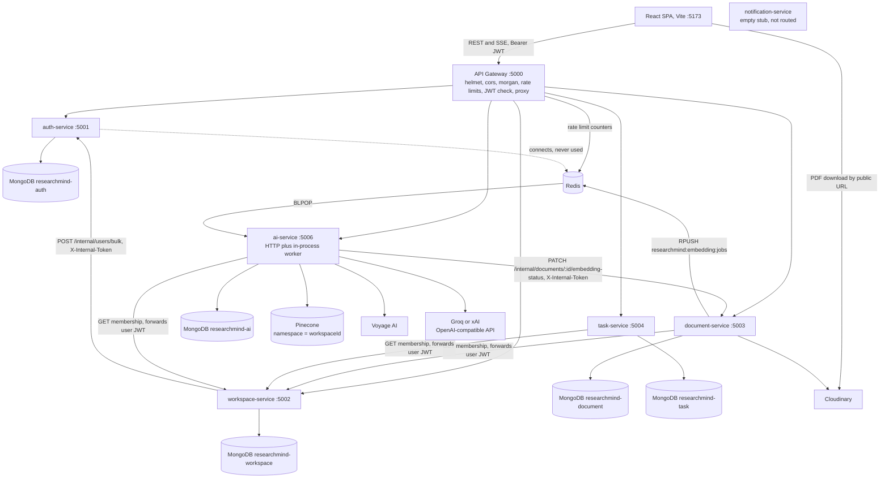
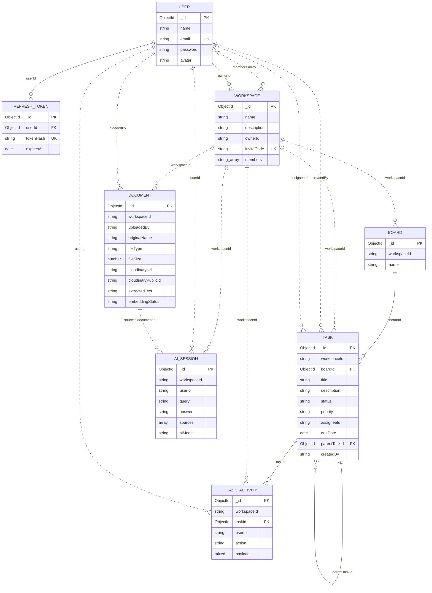
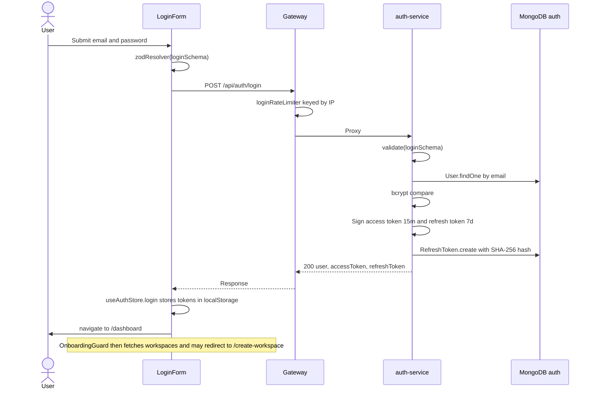
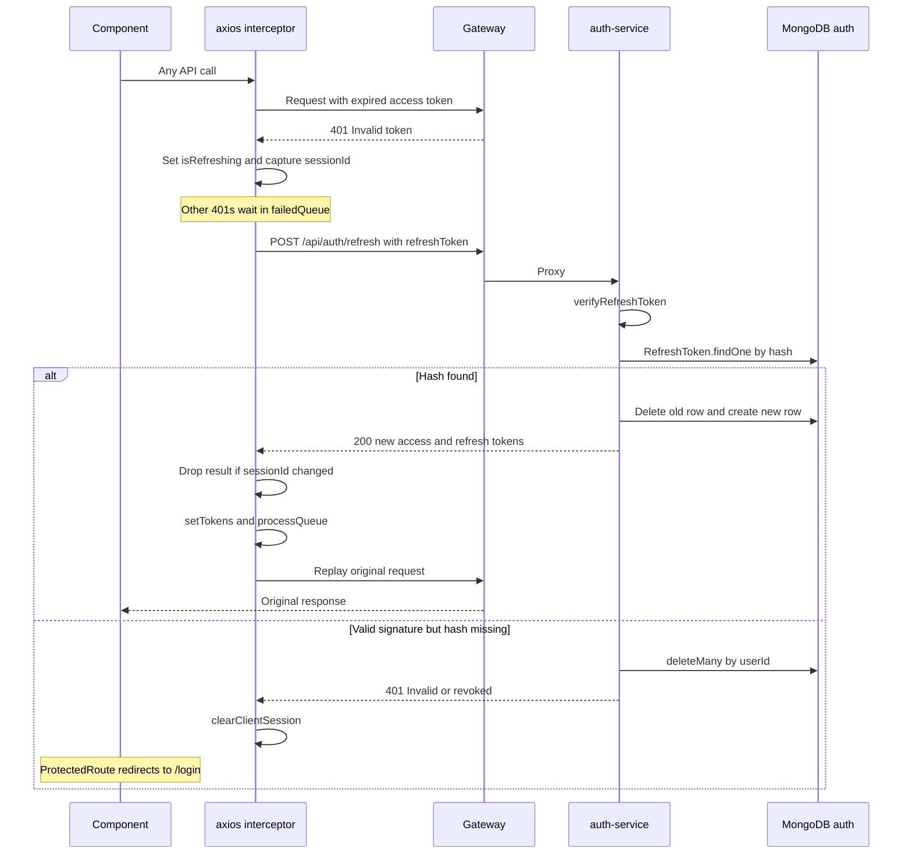
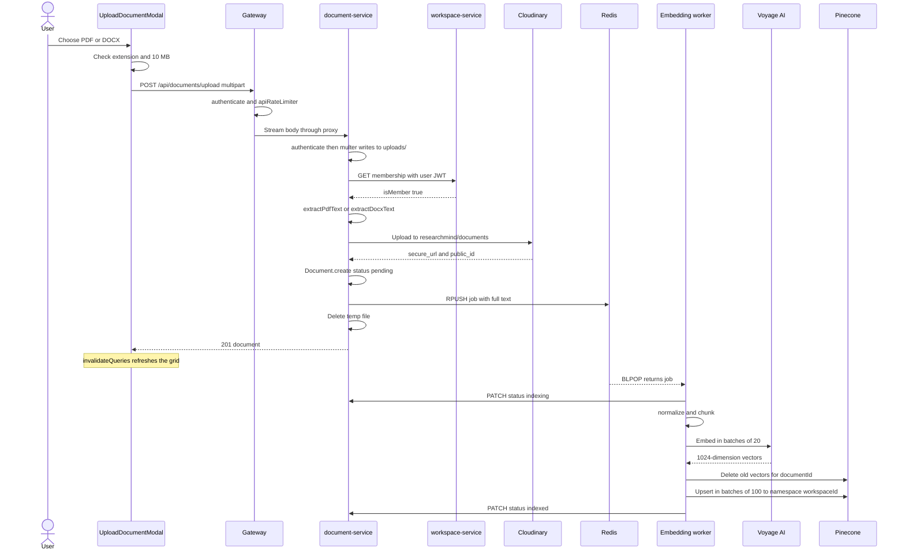
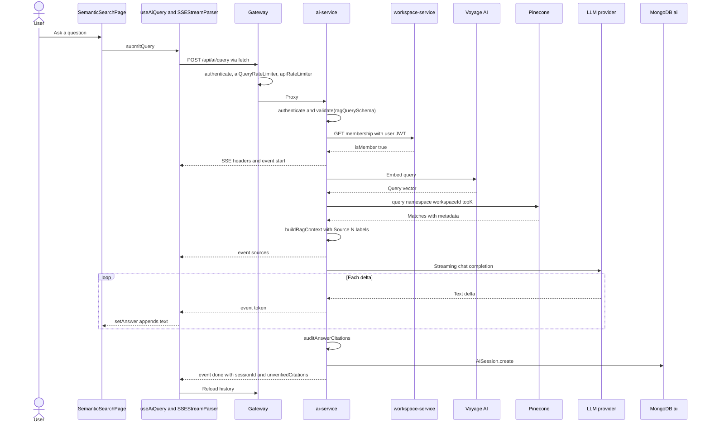
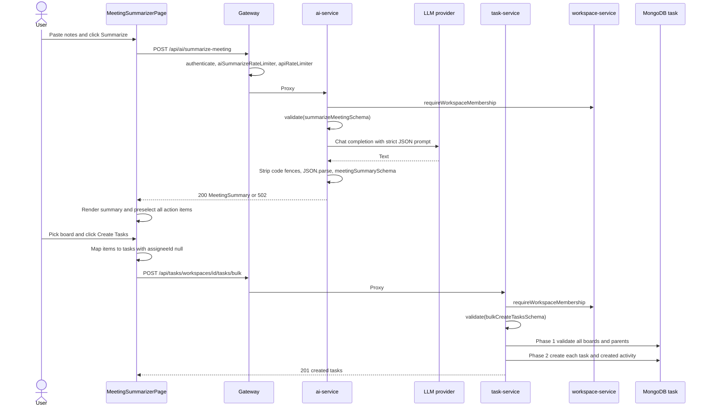
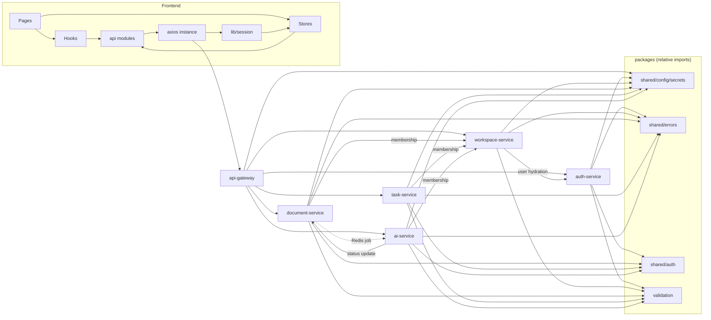
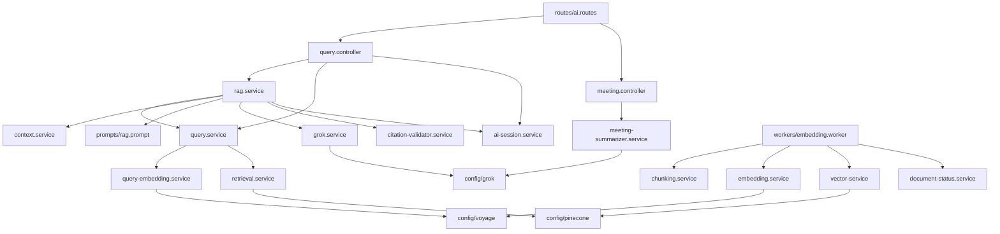

# ResearchMind: Implemented System Documentation

> **Historical snapshot (status note 2026-11-11):** this analysis describes the tree as of 2026-11-02 (HEAD `5f4be4f` plus uncommitted changes). Later fix waves changed much of the behaviour it describes, and it is not maintained. For current behaviour see the [documentation index](docs/README.md) and the *Current Implementation Status* section of the [project README](ResearchMind_readme.md).

A reverse-engineered description of what ResearchMind is meant to be (`ResearchMind_readme.md`) and what the code actually does today, connected section by section.

| | |
|---|---|
| **Analysed state** | Branch `phase-4-meeting-summarizer-task-creatio`, HEAD `5f4be4f`, **plus the uncommitted working tree** |
| **Analysis date** | 2026-11-02 |
| **Reference document** | `ResearchMind_readme.md` (2,509 lines), called "the spec" below |
| **Source of truth** | Source code, configuration and Mongoose schemas. The spec, `docs/`, service READMEs and `BUGFIXING.md` were treated as claims to check |

## How to read this document

**The working tree matters.** 109 tracked or staged files differ from HEAD and 9 files are untracked, including `.github/workflows/ci.yml`, `tests/`, `packages/shared/auth/`, `packages/shared/health/`, `services/auth-service/src/routes/internal.routes.ts` and `frontend/src/components/workspace/JoinWorkspaceModal.tsx`. Everything below describes the working tree. A fresh clone of HEAD would not have these files or changes.

**Evidence levels.** Every claim rests on one of these:

| Level | Meaning |
|---|---|
| **Executed** | I ran it during this analysis |
| **Code-read** | Traced through the source; not exercised at runtime |
| **Requires verification** | Depends on running infrastructure or external accounts I did not use |

**What was executed:**

| Check | Result |
|---|---|
| `npm test` | 5 tests, 5 pass (but see [§26](#26-testing-and-code-quality): they import no application code) |
| `npx tsc --noEmit -p services/<name>` for all 6 active services | No errors |
| `npx tsc --noEmit -p frontend/tsconfig.app.json` | **1 error**, `JoinWorkspaceModal.tsx(59,27)`. This is a real runtime bug, see [§33.1](#331-confirmed-defects-worth-knowing-about) |
| `npx eslint .` in `frontend/` | **44 errors, 4 warnings** |
| `jsonwebtoken` signing the same payload twice within one second | Produces identical tokens, see [§33.1](#331-confirmed-defects-worth-knowing-about) |

**What was not executed:** the services themselves. No end-to-end request ran against MongoDB, Redis, Pinecone, Voyage, the LLM provider or Cloudinary. So every flow below is *code-read*, and external behaviour (index configuration, model output quality, actual provider) is marked where it matters.

**Other documents disagree with the code in places.** `docs/`, `BUGFIXING.md` and service READMEs are partly stale. Where they conflict, this document follows the code and says so.

---

## Contents

| Part | Sections |
|---|---|
| I. Vision and scope | [1 Overview](#1-project-overview) · [2 Reference vision](#2-reference-document-and-original-project-vision) · [3 Objectives](#3-project-objectives-and-scope) |
| II. Technology | [4 Stack](#4-technology-stack) |
| III. Architecture | [5 Intended](#5-intended-architecture) · [6 Actual](#6-actual-system-architecture) · [7 Directory structure](#7-project-directory-structure) · [8 Entry points](#8-application-entry-points) |
| IV. Modules and functionality | [9 Modules](#9-complete-module-documentation) · [10 Functionality](#10-complete-functionality-documentation) |
| V. Data | [11 Database architecture](#11-database-architecture) · [12 Tables and fields](#12-database-tables-and-fields) · [13 Relationships and ER diagram](#13-database-relationships-and-er-diagram) |
| VI. APIs and execution | [14 APIs](#14-api-and-communication-documentation) · [15 Client calls](#15-client-side-api-calls) · [16 Request lifecycle](#16-end-to-end-request-lifecycle) · [17 Workflows vs spec](#17-workflows-compared-with-the-spec) · [18 Business logic](#18-business-logic-and-processing) · [19 Auth](#19-authentication-and-authorization) · [20 State](#20-state-and-data-management) · [21 Middleware](#21-middleware-and-interceptors) · [22 Validation and errors](#22-validation-and-error-handling) · [23 Security](#23-security-implementation) · [24 Integrations](#24-external-integrations) |
| VII. Engineering | [25 Decisions and patterns](#25-architectural-decisions-and-design-patterns) · [26 Testing](#26-testing-and-code-quality) · [27 Build and deployment](#27-build-and-deployment) · [28 Configuration](#28-configuration-and-environment-setup) · [29 Dependencies](#29-module-dependencies-and-data-flow) |
| VIII. Assessment | [30 Spec vs implementation](#30-reference-vs-implementation-comparison) · [31 Status audit](#31-implementation-status-audit) · [32 Challenges](#32-technical-challenges-and-trade-offs) · [33 Limitations and defects](#33-limitations-and-missing-implementations) · [34 Improvements](#34-future-improvements) · [35 Walkthrough](#35-complete-technical-project-walkthrough) · [36 Summary](#36-final-project-summary) |

---

# Part I: Vision and Scope

## 1. Project Overview

ResearchMind is a multi-tenant web application where a student engineering team uploads project documents and asks questions answered from those documents, summarises meeting notes into structured output, and tracks work on a Kanban board.

Today it consists of:

- a **React 19 SPA** (`frontend/`)
- an **API gateway** plus **five active Node/Express microservices**: auth, workspace, document, task, AI (`services/`)
- a **background embedding worker** that runs inside the AI service process by default
- **MongoDB** (one logical database per service), **Redis** (rate limits and a job queue), **Pinecone** (vectors), **Voyage AI** (embeddings), an **OpenAI-compatible LLM endpoint** (Groq or xAI), and **Cloudinary** (file storage)

**In one sentence of honest status:** Phases 1 to 4 of the spec's 9-phase plan are substantially built and connected, with a handful of real defects. Phases 5 to 9 (AI agent, literature review, chat, notifications, deployment) do not exist.

## 2. Reference Document and Original Project Vision

The spec describes a much larger system than what exists. It frames the product at three levels:

1. **Centralised knowledge base:** all project artifacts in one place.
2. **Semantic intelligence (RAG):** natural-language questions answered from the team's own documents, with citations.
3. **Autonomous AI agents:** a Claude-powered ReAct loop with 8 tools that can search, create tasks, draft documents and post messages.

It specifies 7 microservices behind a gateway on ports 3000 to 3006, Redis pub/sub as an event bus, Socket.io for chat and presence, Anthropic Claude as the LLM, 10 product modules, and deployment to Railway and Vercel with GitHub Actions CI.

**Spec phases and their actual state:**

| Phase | Spec goal | Spec's own checkbox | Actual state (from code) |
|---|---|---|---|
| 1 | Foundation, auth, workspaces, gateway | Complete | **Built**, with deviations (invite codes rather than email invites, no roles) |
| 2 | Document ingestion | Complete | **Built**: PDF and DOCX only |
| 3 | RAG pipeline | Backend complete, frontend unticked | **Built, including the frontend** (the checkbox is stale) |
| 4 | Meeting summariser and tasks | All unticked | **Mostly built** (the checkboxes are stale) |
| 5 | AI agent | Unticked | **Not started** |
| 6 | Literature review | Unticked | **Not started** (placeholder page only) |
| 7 | Real-time chat | Unticked | **Not started** |
| 8 | Notifications and dashboard | Unticked | **Not started** (empty service stub, decorative bell icon) |
| 9 | Polish and deploy | Unticked | **Partial**: dark mode toggle and responsive shell exist; nothing is deployed |

Note that the spec was edited as work proceeded. Its Phase 2 and 3 checklists mention actual implementation details (`POST /api/documents/upload`, `researchmind:embedding:jobs`, `voyage-4`, Grok), while its architecture sections still describe the original design. So the spec contradicts itself in places, for example Claude in §7 and Grok in §16.

## 3. Project Objectives and Scope

| Objective from the spec | Delivered? |
|---|---|
| Upload and centrally store project documents | Yes, for PDF and DOCX |
| Answer questions from documents with citations | Yes, streamed over SSE |
| Isolate each team's data | Yes, enforced at the API and in Pinecone namespaces |
| Turn meeting notes into decisions and tasks | Yes, with manual confirmation |
| Kanban task management | Yes, three columns, with activity history and subtasks |
| Autonomous multi-step agent | No |
| Generated literature reviews and report drafts | No |
| Real-time collaboration and chat | No |
| Notifications | No |
| Production deployment | No |

---

# Part II: Technology

## 4. Technology Stack

Version numbers are the ranges declared in `package.json`. "In spec?" compares against spec §7.

### 4.1 Backend

| Technology | Purpose here | Where used | In spec? |
|---|---|---|---|
| Node.js 20 | Runtime | All services; CI pins 20 | Yes |
| TypeScript `^6.0.3` | Language for every service | All `src/` | **Changed**: spec's layout shows plain `.js` |
| Express `^5.2.1` | HTTP framework | All services. Express 5 forwards rejected async handlers to the error middleware, which is why `updateEmbeddingStatus` works without `asyncHandler` | Yes |
| Zod `^4.4.3` | Request validation and LLM output validation | `packages/validation`, frontend forms | **Replaces Joi** |
| Mongoose `^9` | MongoDB ODM | auth, workspace, document, task, AI | Yes |
| ioredis | Redis client for rate limits and queue | gateway, document, AI | Yes |
| `redis` `^6` | A second Redis client | auth-service only: connects, then is never used | **Added, effectively unused** |
| jsonwebtoken `^9` | HS256 JWT signing and verification | auth signs; every service verifies | Yes |
| bcryptjs `^3` | Password hashing, 10 rounds | `auth-service/src/utils/hash.ts` | **Changed**: spec says `bcrypt` with 12 rounds |
| http-proxy-middleware `^3` | Gateway reverse proxy | `api-gateway/src/app.ts` | Yes |
| express-rate-limit `^8`, rate-limit-redis `^6` | Per-route limits stored in Redis | `rate-limit.middleware.ts` | **Changed**: spec hand-writes a limiter |
| helmet | Security headers | gateway (CSP off), auth, document, task, AI. **Not workspace-service** | Added |
| cors | CORS | gateway, auth, document, task, AI | Yes |
| morgan | Request logging | gateway, auth, document, task, AI | Yes |
| winston | Structured logs | **document-service only** | Partial: spec wants it everywhere |
| multer `^2` | Multipart uploads to temp disk | document-service | Yes |
| pdf-parse `^2` | PDF text extraction (`PDFParse` class) | `pdf-extractor.ts` | Yes |
| mammoth | DOCX text extraction | `docx-extractor.ts` | Yes |
| cloudinary `^2` | Original file storage | document-service | Yes |
| swagger-ui-express | API docs at `/api-docs` | gateway, document, task. AI has a `swagger.json` that is **not mounted** | Added |
| openai `^7.5.0` | SDK for the **OpenAI-compatible** LLM endpoint | `ai-service/src/config/grok.ts` | **Replaces Anthropic SDK** |
| @pinecone-database/pinecone `^5` | Vector database client | AI | Yes |
| @langchain/community | `VoyageEmbeddings` wrapper | `ai-service/src/config/voyage.ts` | **Added** (spec implies direct use) |
| @langchain/textsplitters | `RecursiveCharacterTextSplitter` | `chunking.service.ts` | **Replaces** the spec's hand-written chunker |

**Installed but not imported anywhere in source:** `cookie-parser` (auth-service, a remnant of the cookie design in the spec), `@langchain/pinecone` and `@langchain/core` as direct imports (AI; `core` may still be a peer of the other LangChain packages), `winston` in ai-service and notification-service.

**Imported but not declared in that service's `package.json`:** several services rely on npm workspace hoisting. For example `jsonwebtoken` is not listed in `api-gateway`, and `express` and `dotenv` are not listed in `auth-service` or `workspace-service`. This works in the monorepo and would break if a service were installed on its own.

**In the spec, absent from the code:** `@anthropic-ai/sdk`, Socket.io, Joi, Nodemailer/Resend, PM2, Jest, Supertest, k6.

### 4.2 Frontend

| Technology | Purpose here | In spec? |
|---|---|---|
| React `^19.2` | UI | **Spec says 18** |
| Vite `^8` | Dev server and build | Yes |
| react-router-dom `^7.17` | Routing | **Spec says v6** |
| Zustand `^5` | Auth and workspace stores with `persist` | Yes, but only 2 of the 8 stores in the spec |
| TanStack React Query `^5` | Server state, **documents only** | **Added** |
| Tailwind CSS `^4`, shadcn base styles | Styling | Yes |
| axios | HTTP with refresh interceptor | Yes |
| Native `fetch` + `ReadableStream` | SSE consumption | Spec's table says `EventSource`, its sample code uses `fetch`. `fetch` is required here because `EventSource` cannot POST or send an `Authorization` header |
| react-hook-form + @hookform/resolvers | Login and register forms | Added |
| Zod | Client validation | Added |
| @dnd-kit/core, /sortable, /utilities | Kanban drag and drop | Yes |
| react-pdf + pdfjs-dist | In-app PDF viewer | Yes. The PDF.js worker loads from `unpkg.com` at runtime |
| react-markdown, remark-gfm, remark-math, rehype-katex, katex | Markdown and math rendering via `MathMarkdown`, used **only** for the meeting summary | Added |
| lucide-react | Icons | Added |
| radix-ui, class-variance-authority, clsx, tailwind-merge | UI primitives (`button`, `card`) | Implied by shadcn |

**Declared but not effectively used:** `recharts` (imported only by the orphaned `ResearchActivityCard`), `@hugeicons/*` (no imports), `tw-animate-css` (no imports, although `animate-in` classes appear in the markup).

**In the spec, absent:** `react-dropzone` (drag-and-drop is hand-written in `UploadDocumentModal`), TipTap, `socket.io-client`.

### 4.3 Data, AI and infrastructure

| Tool | Spec | Actual |
|---|---|---|
| Primary DB | MongoDB | MongoDB 7 via Docker Compose |
| Cache / queue | Redis for cache, pub/sub, presence, rate limits, queue | Redis 7 for **rate limits and one queue only**. No cache, no pub/sub, no presence |
| Vector DB | Pinecone | Pinecone. Index name from `PINECONE_INDEX` |
| LLM | Anthropic Claude (`claude-sonnet-4-20250514`) | **OpenAI-compatible client against Groq or xAI**, chosen by API key prefix, see [§24](#24-external-integrations) |
| Embeddings | Voyage `voyage-2` | Voyage. Code default `voyage-3`, `.env.example` and docs say `voyage-4`, the local `.env` sets `voyage-3` |
| File storage | Cloudinary or S3 | Cloudinary |
| Container | Compose for everything | Compose for **MongoDB, Redis and mongo-express only** |
| Hosting | Railway, Vercel, Atlas, Upstash | None configured |

---

# Part III: Architecture and Structure

## 5. Intended Architecture

From spec §6 and §8: a React client talks over HTTPS and WSS to one API gateway on `:3000`. The gateway applies request IDs, Morgan, CORS, Redis rate limits and JWT verification, then **injects trusted headers** (`X-User-Id`, `X-User-Role`) and proxies to six services (Auth `:3001` which also owns workspaces, Doc `:3002`, Chat `:3003`, Tasks `:3004`, AI `:3005`, Notifications `:3006`). Services communicate primarily through a **Redis pub/sub event bus** (`workspace:events`). Socket.io with a Redis adapter handles real-time traffic. An embedding worker consumes `embed:queue`, and a failed job goes to a dead-letter list `embed:failed`.

## 6. Actual System Architecture



**Key differences from the intended architecture:**

| Topic | Intended | Actual | Why it matters |
|---|---|---|---|
| Ports | 3000 to 3006 | 5000 to 5006, 5005 reserved for the stub | Cosmetic |
| Workspaces | Inside Auth | **Separate workspace-service** | One more service, cleaner boundary |
| Identity propagation | Gateway injects trusted headers, services trust them | **Gateway verifies the JWT, then forwards it; each service verifies it again** | Defence in depth: a service reached directly still rejects bad tokens. Cost: the signing secret lives in six services |
| Inter-service communication | Redis pub/sub events | **Synchronous HTTP** plus one Redis list | No event bus. A workspace-service outage makes membership checks fail closed, so document, task and AI calls answer 403 |
| Real-time | Socket.io | **SSE on one AI endpoint** | No chat, presence, or push updates |
| Refresh token store | Redis, one per user | **MongoDB, one row per session** | Multiple concurrent sessions work; no Redis dependency for login |
| Worker location | Doc service | **AI service**, in-process by default | Embedding code sits with the AI code |
| Chat service | `:3003` | **Does not exist** | |
| Notification service | `:3006` | **Empty files** | |

**Architectural style.** It is a real microservice split at the process and database level, in a monorepo, but with shared source files rather than versioned packages. See [§25](#25-architectural-decisions-and-design-patterns).

**Possible explanation, not stated in the code:** moving to direct HTTP with no event bus fits the fact that the features that would consume events (chat, notifications) were never built.

## 7. Project Directory Structure

```text
ReserchMind/
├── frontend/                     React SPA (npm workspace "frontend")
│   └── src/
│       ├── api/                  axios instance and one module per backend service
│       ├── components/
│       │   ├── auth/             AuthLayout, LoginForm, RegisterForm, PasswordStrength
│       │   ├── dashboard/        StatCard, InsightCard (used); 3 orphaned mock cards
│       │   ├── documents/        Grid, card, toolbar, upload modal, PDF viewer, states
│       │   ├── kanban/           CreateTaskModal, TaskDetailModal
│       │   ├── layout/           Sidebar, TopBar, RightContextPanel
│       │   ├── ui/               button, card, MathMarkdown (used); input, label (unused)
│       │   └── workspace/        CreateWorkspaceModal, JoinWorkspaceModal (used); 5 orphaned stepper files
│       ├── hooks/                useAiQuery, useDocuments, useSignOut
│       ├── layouts/AppShell.tsx  Authenticated page frame
│       ├── lib/                  queryClient, session teardown, zod schemas, utils
│       ├── pages/                Login, Register, CreateWorkspace, Overview, Documents,
│       │                         SemanticSearch, MeetingSummarizer, Kanban
│       ├── routes/               AppRouter (with OnboardingGuard), ProtectedRoute
│       ├── store/                auth.store, workspace.store (Zustand + persist)
│       ├── types/                TS interfaces mirroring API payloads
│       └── utils/                SSE parser, file formatting
├── services/
│   ├── api-gateway/              Proxy, JWT check, Redis rate limits, Swagger UI
│   ├── auth-service/             Users, refresh tokens, /internal/users/bulk
│   ├── workspace-service/        Workspaces, invite codes, membership API
│   ├── document-service/         Upload, extraction, Cloudinary, queue producer
│   ├── task-service/             Boards, tasks, subtasks, activity log
│   ├── ai-service/               RAG, meeting summariser, embedding worker
│   └── notification-service/     Stub: empty app.ts and server.ts, empty folders
├── packages/
│   ├── shared/                   secrets, authenticate, internal auth, errors, health
│   ├── validation/               Zod schemas plus the validate() middleware
│   └── shared-config/            tsconfig.base.json (no service extends it)
├── tests/                        2 self-contained test files (untracked)
├── postman/, .postman/           Postman collections for auth and workspaces
├── docs/                         Architecture, ADRs, onboarding. Gitignored except 3 tracked files
├── docker/mongo, docker/redis    Empty directories
├── ResearchMind-page-images/     UI mockups (gitignored)
├── ResearchMind_readme.md        The spec
├── BUGFIXING.md                  Audit backlog, partly stale
├── docker-compose.yml            MongoDB, Redis, mongo-express
└── package.json                  npm workspaces root, concurrently dev scripts
```

**Every backend service follows the same internal layout:** `server.ts` (boot) → `app.ts` (Express wiring) → `routes/` → `middlewares/` → `controllers/` (HTTP) → `services/` (logic) → `models/` (Mongoose).

**Compared with spec §17:**

| Spec | Actual |
|---|---|
| `apps/client`, `apps/*-service` | `frontend/`, `services/*` |
| `doc-service`, `extractors/`, `workers/embeddingWorker.js` | `document-service`, `utils/*-extractor.ts`, worker moved to `ai-service/src/workers/` |
| `ai-service/lib/{pinecone,embeddings,claude,chunker}` | `config/{pinecone,voyage,grok}.ts`, `services/chunking.service.ts` |
| `ai-service/agent/` | Does not exist |
| `chat-service/` | Does not exist |
| `packages/shared/{constants,validators}.js` | `packages/shared/*` and a separate `packages/validation/` |
| `components/ai/`, `components/tasks/`, `stores/` | AI logic is in `pages/`, `components/kanban/`, `store/` |
| `docker-compose.prod.yml`, per-service Dockerfiles, root `.env.example` | None exist. `.env.example` files are per-service |

**The `packages/` folder is not a set of real packages.** `packages/shared` and `packages/validation` have no `package.json`, so although the root declares `"workspaces": ["packages/*"]`, services import them by relative path:

```ts
import { errorMiddleware } from "../../../packages/shared/errors/error.middleware";
```

That is also why every `tsconfig.json` sets `rootDir: "../.."`, which in turn breaks several `start` scripts, see [§27](#27-build-and-deployment). ADR 0002 describes this as NPM workspaces with "clean TypeScript path resolution", which overstates it.

## 8. Application Entry Points

| Process | Entry | Boot sequence |
|---|---|---|
| Frontend | `frontend/src/main.tsx` | `createRoot` → `App` → `QueryClientProvider` → `AppRouter` |
| Gateway | `api-gateway/src/server.ts` | `dotenv` → `assertRequiredSecrets(JWT_ACCESS_SECRET)` → import `app` → listen on `PORT` or 5000. Importing the rate-limit module opens the Redis connection |
| Auth | `auth-service/src/server.ts` | Secrets (`JWT_ACCESS_SECRET`, `JWT_REFRESH_SECRET`) → `connectDB` → `connectRedis` (failure only logged) → listen on 5001 |
| Workspace | `workspace-service/src/server.ts` | Secrets → `connectDB`, with `syncIndexes()` outside production → listen on 5002 |
| Document | `document-service/src/server.ts` | Secrets (`JWT_ACCESS_SECRET`, `INTERNAL_SERVICE_TOKEN`) → `connectDB` → `syncPendingDocuments()` (not awaited) → listen on 5003 |
| Task | `task-service/src/server.ts` | Secrets → `connectDB` with a fallback to a local unauthenticated URI, and `syncIndexes()` outside production → listen on 5004 |
| AI HTTP | `ai-service/src/server.ts` | Secrets → `connectDB` (failure only warns) → `redis.ping()` → `startEmbeddingWorker()` in the background → listen on 5006 |
| AI worker (optional) | `ai-service/src/worker.ts` | Secret (`INTERNAL_SERVICE_TOKEN`) → `startEmbeddingWorker()` |
| Stub | `notification-service/src/*.ts` | Both files are empty. No `dev` script |

**Why `dotenv.config()` before imports works here.** Services compile to CommonJS, where imports execute in source order. So `dotenv.config()` and `assertRequiredSecrets()` run before `import app` loads modules that read `process.env` at load time (for example `config/grok.ts` and `config/pinecone.ts` throw at import if keys are missing). Under native ESM hoisting this ordering would not hold.

**Worker duplication to be aware of.** `ai-service/src/server.ts` already starts the worker in-process, but `docs/onboarding.md` also tells you to run `npm run dev:worker`. Doing both creates two competing `BLPOP` consumers. That is safe for correctness, since each job is popped once, but it is probably not what the guide intends. The root `npm run dev` starts only the HTTP process.

---

# Part IV: Modules and Functionality

## 9. Complete Module Documentation

### 9.1 `packages/shared`

| File | Exports | Used by |
|---|---|---|
| `config/secrets.ts` | `requireSecret`, `assertRequiredSecrets`, `SecretConfigurationError`, `MIN_SECRET_LENGTH = 32` | All services at boot, plus module-load checks in auth middleware and `jwt.ts` |
| `auth/authenticate.ts` | `authenticate`, `AuthRequest` | document, task, AI |
| `auth/internal-auth.middleware.ts` | `requireInternalServiceToken` | auth-service `/internal` |
| `errors/AppError.ts` | `AppError(message, statusCode = 500)` | Everywhere |
| `errors/asyncHandler.ts` | `asyncHandler(fn)` | Controllers |
| `errors/error.middleware.ts` | `errorMiddleware` | All Express apps except the gateway |
| `health/healthCheck.ts` | `createHealthHandler` | **Nothing. Unused** |

`requireSecret` rejects a value that is missing, empty, a `<placeholder>`, shorter than 32 characters, or on a list of known-weak literals. Error messages contain only the variable name, never the value.

### 9.2 `packages/validation`

`validate(schema)` is Express middleware that runs `schema.safeParse(req.body)`. On failure it responds `400 { success: false, message, errors[] }`. On success it replaces `req.body` with the parsed result, which **strips unknown keys** (Zod's default for `z.object`). That is why extra fields a client might send never reach the service layer. Schema files: `auth`, `workspace`, `document`, `task`, `ai`.

### 9.3 `api-gateway`

| File | Responsibility |
|---|---|
| `src/app.ts` | Middleware order and proxy table. **No body parser**, so request bodies including multipart uploads stream straight through. `handleProxyError` turns connection failures into `503` |
| `middlewares/auth.middleware.ts` | Verifies Bearer JWT with pinned HS256; sets `req.user.userId` so the limiters can key on the user |
| `middlewares/rate-limit.middleware.ts` | Five limiters on Redis, failing open if Redis errors |
| `src/swagger.json` | OpenAPI document served at `/api-docs`. Omits document delete and reindex, workspace detail and members, and AI sessions |

**Ordering in `app.ts`.** `/api/auth` is proxied with **no JWT check** at the gateway (only `login` and `register` get limiters; `refresh`, `me` and `logout` are unthrottled). Every other prefix runs `authenticate` first, then the per-user limiter, then the proxy. `pathFilter` retains the full path, so `/api/tasks/...` arrives at the service as `/api/tasks/...`. `/internal/*` is not in the proxy table, so it cannot be reached through the gateway.

### 9.4 `auth-service`

| File | Responsibility |
|---|---|
| `models/User.ts`, `models/RefreshToken.ts` | Schemas |
| `services/auth.service.ts` | `registerUser`, `loginUser`, `refreshAccessToken`, `logoutUser`, `getCurrentUser`, `getUsersBulk` |
| `utils/jwt.ts` | Sign and verify with pinned HS256; separate access and refresh secrets |
| `utils/hash.ts` | bcryptjs with 10 rounds |
| `routes/internal.routes.ts` | `POST /internal/users/bulk`, gated by the shared secret |
| `config/redis.ts` | Connects a client. **No code ever reads or writes through it** |

### 9.5 `workspace-service`

| File | Responsibility |
|---|---|
| `models/Workspace.ts` | `name`, `description`, `ownerId`, `inviteCode`, `members[]` |
| `services/workspace.service.ts` | Create (retries up to 5 times on invite-code collision), list, join, membership check, detail, members with profile hydration |
| `utils/invite-code.ts` | 8 characters from `crypto.randomBytes` over a 32-letter alphabet that omits look-alikes such as `0`, `O`, `1`, `I`. With 256 mod 32 = 0 the distribution is unbiased |

This service is the **authorization oracle** for the whole system: document, task and AI ask it `GET /api/workspaces/:id/membership` on every workspace-scoped request.

### 9.6 `document-service`

| File | Responsibility |
|---|---|
| `middlewares/upload.middleware.ts` | Multer disk storage in `uploads/`, 10 MB limit, `fileFilter` |
| `services/document.service.ts` | `uploadDocument`, `uploadToCloudinary`, `createDocument`, `getWorkspaceDocuments`, `getDocumentById`, `deleteDocument`, `reindexDocument`, `syncPendingDocuments` |
| `controllers/document.controller.ts` | HTTP handlers. Membership checks are here rather than in middleware because some routes must load the document first to learn its workspace |
| `controllers/upload.controller.ts` | One-line delegate into the service (the service layer holds Express handling for upload, unlike elsewhere) |
| `queues/embedding.queue.ts` | `addEmbeddingJob` runs `RPUSH researchmind:embedding:jobs` |
| `routes/internal.routes.ts` | `PATCH /internal/documents/:id/embedding-status` |
| `middlewares/internal-auth.middleware.ts` | A local duplicate of the shared `requireInternalServiceToken` |
| `utils/*-extractor.ts` | `extractPdfText`, `extractDocxText` |
| `utils/workspace-checker.ts` | HTTP membership client. Copies also exist in task and AI |
| `utils/logger.ts` | Winston: Console, `error.log`, `combined.log` in the working directory |

### 9.7 `task-service`

| File | Responsibility |
|---|---|
| `services/board.service.ts` | Board CRUD; delete refuses with 409 when tasks exist unless `cascade` |
| `services/task.service.ts` | Task CRUD, `bulkCreateTasks`, `assertParentChainIsSafe`, `collectSubtree` |
| `services/task-activity-diff.service.ts` | `detectTaskActivityChanges`: a pure rule list comparing before and after |
| `services/task-activity.service.ts` | `createActivity`, `getTaskActivities` |
| `middlewares/workspace.middleware.ts` | `requireWorkspaceMembership` |

Code comments in `board.service.ts` and `task.service.ts` refer to a `withOptionalTransaction` helper. **It does not exist anywhere in the repository.** Multi-step writes are not transactional; safety comes from write ordering.

### 9.8 `ai-service`

| File | Responsibility |
|---|---|
| `workers/embedding.worker.ts` | `startEmbeddingWorker` loop, `processEmbeddingJob` |
| `services/chunking.service.ts` | `normalizeText`, `chunkText` |
| `services/embedding.service.ts` | `generateEmbeddings`, batching and 429 backoff |
| `services/vector-service.ts` | `upsertDocumentEmbeddings`, `deleteDocumentEmbeddings` |
| `services/document-status.service.ts` | `updateDocumentEmbeddingStatus`, an internal HTTP call |
| `services/query-embedding.service.ts` | `generateQueryEmbedding`, with 429 retries |
| `services/retrieval.service.ts` | `searchWorkspace`, the Pinecone query |
| `services/query.service.ts` | `semanticSearch`: embed + search, clamps `topK` to 1..10 |
| `services/context.service.ts` | `buildRagContext`: `[Source N]` block |
| `prompts/rag.prompt.ts` | `RAG_SYSTEM_PROMPT`, `buildRagUserPrompt` |
| `services/grok.service.ts` | `streamGrokResponse` with an idle watchdog; `generateGrokResponse` (**defined, never called**) |
| `services/rag.service.ts` | `runRagStreamQuery`: the orchestrator |
| `services/citation-validator.service.ts` | `auditAnswerCitations` |
| `services/ai-session.service.ts` | `saveAiSession`, `getWorkspaceAiSessions` |
| `services/meeting-summarizer.service.ts` | `generateMeetingSummary` |
| `errors/llm.error.ts` | `LlmUnavailableError` (HTTP 502) with a fixed public message |

Manual scripts, not tests: `scripts/test-pinecone.ts`, `scripts/test_vector_query_e2e.ts`, `scripts/verify-document-vectors.ts`, `document-service/src/scripts/test_cloudinary_storage.ts`. They need live credentials. `utils/verify-pinecone.ts` (checks the index dimension is 1024) is not called by anything.

### 9.9 `frontend`

| Layer | Modules | Notes |
|---|---|---|
| Routing | `AppRouter`, `ProtectedRoute`, `OnboardingGuard` (inside `AppRouter.tsx`) | Guards nest: authenticated → has resolved workspaces → `AppShell` |
| API | `api/axios.ts`, `auth.api`, `workspace.api`, `document.api`, `task.api`, `ai.api` | `axios.ts` owns refresh; `ensureFreshToken` serves SSE |
| State | `auth.store`, `workspace.store`, `lib/queryClient`, `lib/session` | [§20](#20-state-and-data-management) |
| Hooks | `useAiQuery` (SSE state machine), `useDocuments` (React Query), `useSignOut` | |
| Pages | Overview, Documents, SemanticSearch, MeetingSummarizer, Kanban, CreateWorkspace, Login, Register | |

**Routes that exist:**

| Path | Page |
|---|---|
| `/login`, `/register` | Public |
| `/create-workspace` | Onboarding: join or create (authenticated, no workspace required) |
| `/dashboard` | `OverviewPage` |
| `/dashboard/tasks` | `KanbanPage` |
| `/dashboard/documents` | `DocumentsPage` |
| `/dashboard/ai-researcher`, `/app/workspace/:id/search` | `SemanticSearchPage`. The `:id` param is ignored; the active workspace always comes from the store |
| `/dashboard/meeting-notes` | `MeetingSummarizerPage` |
| `/dashboard/sources`, `analytics`, `literature-review`, `report-drafter`, `settings` | `PlaceholderPage` ("currently in development") |
| `*` | Redirect to `/login` |

The spec's routes (`/app/workspace/:id/...`, `/agent`, `/review`, `/channels/:id`) are not implemented, apart from the one alias above.

**Orphaned frontend code (not imported by anything):**

- `components/dashboard/PriorityTasksCard.tsx`, `ResearchActivityCard.tsx`, `TeamWorkloadCard.tsx`
- `components/workspace/InviteTeamStep.tsx`, `ProjectDomainStep.tsx`, `ReviewWorkspaceStep.tsx`, `WorkspaceDetailsStep.tsx`, `WorkspaceStepper.tsx`, and with them `lib/validations/workspace.schema.ts`
- `components/ui/input.tsx`, `label.tsx`; `App.css`
- Exported but uncalled API functions: `searchWorkspaceVectors`, `authApi.getProfile`, `authApi.refreshToken`

**Decorative UI with no behaviour:** the TopBar search box and `⌘K` badge; the notification bell and its always-on red dot; the "RAG Engine Status: Operational" panel, which is hard-coded text and not a health check.

## 10. Complete Functionality Documentation

Each feature lists intended behaviour, actual behaviour, and status. Execution sequences are in [§16](#16-end-to-end-request-lifecycle).

### 10.1 Registration and login

- **Spec:** register, login, access token in the response body, refresh token in an httpOnly cookie.
- **Actual:** `LoginForm` and `RegisterForm` validate with react-hook-form and Zod, call `authApi`, then store user and **both tokens** via `useAuthStore` in `localStorage`. Backend validates with `registerSchema` or `loginSchema`, hashes with bcryptjs, issues tokens, stores the SHA-256 of the refresh token.
- **Differences:** no cookie. Client and server password rules differ: the client requires 8 characters, the server also requires a letter and a digit, so `aaaaaaaa` passes the form and gets a 400 from the API.
- **Not built:** `PUT /auth/me`, `forgot-password`, `reset-password`.
- **Status:** works; partial against the spec.

### 10.2 Token refresh and rotation

- **Spec:** rotate on every refresh; reuse revokes all sessions; store in Redis.
- **Actual:** `refreshAccessToken` verifies the signature, looks up the hash in MongoDB, and if it is absent treats that as reuse and runs `RefreshToken.deleteMany({ userId })`. Otherwise it deletes the old row and issues a new pair.
- **Client:** the axios interceptor queues concurrent 401s behind a single refresh and replays them. `sessionId` in the store prevents a refresh that lands after sign-out from resurrecting the session.
- **Status:** matches the spec's behaviour with a different store, with one race, see [§33.1](#331-confirmed-defects-worth-knowing-about).

### 10.3 Sign out

`useSignOut` → `signOutClientSession` → `POST /auth/logout` with the refresh token (best effort) → `clearClientSession` clears workspace state and the query cache, then auth, then removes the `localStorage` keys. Clearing auth last means no component can observe "authenticated with the previous user's data". Sign Out appears in three places (TopBar, onboarding page, workspace-unavailable screen) because the last two render outside `AppShell`.

### 10.4 Workspaces

- **Spec:** slug, domain, roles (`lead`, `member`, `advisor`), email invites with tokens, member management, read-only advisors.
- **Actual:** name and description only. `members` is a flat `string[]` of user IDs. Joining uses a shared 8-character invite code that never rotates or expires. "Owner" and "Member" labels in the UI are derived client-side from `ownerId`, and **no server code treats them differently**: any member can do anything, including deleting any document or task.
- **Switching:** `setCurrentWorkspace` changes the store, and workspace-scoped pages refetch through effects or query keys that depend on `currentWorkspace._id`.
- **Onboarding guard:** `OnboardingGuard` waits on `hasFetchedWorkspaces`, so a not-yet-fetched empty list is never mistaken for "no workspaces", and a failed fetch shows a retry screen rather than redirecting.
- **Not built:** update or delete workspace, leave workspace, remove member, change role, rotate invite code.
- **Status:** core flow works; simplified against the spec. The sidebar Join modal is broken and onboarding join is case-sensitive, see [§33.1](#331-confirmed-defects-worth-knowing-about).

### 10.5 Document upload and extraction

- **Spec:** PDF, DOCX, MD, TXT; 20 MB; return immediately; extract text; queue for embedding.
- **Actual:** **PDF and DOCX only, 10 MB.** The handler does extraction and the Cloudinary upload **synchronously inside the request**, so a slow upload holds the HTTP call open; only embedding is asynchronous. Fields are `originalName`, `fileType`, `fileSize`, `cloudinaryUrl`, `cloudinaryPublicId`, `extractedText`, `embeddingStatus`. Spec fields `title`, `wordCount`, `chunkCount`, `tags` do not exist.
- **Temp file:** always removed, on success or failure.
- **Enqueue failure:** the document is kept and marked `failed` rather than failing the upload.
- **Cloudinary resource type:** PDFs use `resource_type: "image"` and DOCX use `raw`. The `image` type is what makes a PDF renderable from a URL.
- **Filter gaps:** `fileFilter` passes if the extension **or** the MIME type matches, and it allows `.doc` and generic ZIP MIME types. The handler then checks the extension, so a `.doc` or a mis-typed file gets past Multer and fails as a generic **500** rather than a clean 400. Over-size files also surface as 500, since `errorMiddleware` has no case for `MulterError`.
- **Scanned PDFs:** with no text layer, extraction returns an empty string. The upload succeeds, and the worker then marks the document `failed` with "Document contains no usable text". There is no OCR.
- **Status:** works; narrower than the spec.

### 10.6 Document library and viewer

`DocumentsPage` shows a grid with client-side name search and filter chips, using React Query. Clicking a PDF opens `PdfViewerModal` (paging, zoom, arrow keys, Escape). Status badges reflect `pending`, `indexing`, `indexed`, `failed`. A Retry button appears for `failed` and `pending`.

- **No live status:** there is no polling or socket, and `refetchOnWindowFocus` is off with a 2-minute `staleTime`. A badge stays on "Pending" until something refetches.
- **DOCX click does nothing:** `DocumentCard.handleClick` acts only for PDFs, despite the tooltip "Open in new tab". DOCX files can only be opened from an AI citation.
- **Spec endpoints absent:** `GET /docs/:id/content`, `/file`, `/workspace/:wid/status`.

### 10.7 Document deletion and re-index

- **Delete, spec:** remove the record and the vectors.
- **Delete, actual:** removes the Cloudinary asset and the Mongo record only. **Vectors remain in Pinecone.** The comment on `deleteDocument` says "and vector embeddings" but no code does this, and nothing calls `deleteDocumentEmbeddings` outside the worker and a manual script. See [§33.1](#331-confirmed-defects-worth-knowing-about).
- **Re-index:** sets status to `pending` and re-enqueues. The worker replaces old vectors before upserting new ones, so re-indexing is idempotent.
- **Status:** delete is partially implemented; re-index works.

### 10.8 Embedding pipeline

See [§16.3](#163-document-upload-and-embedding) and [§18.3](#183-chunking-and-embedding).

### 10.9 RAG Q&A ("AI Researcher")

- **Spec:** `POST /ai/search` streams an answer with sources, and file-type filters apply at retrieval.
- **Actual:** the streaming endpoint is `POST /api/ai/query`. `POST /api/ai/search` is a retrieval-only debug endpoint that returns chunks as JSON and has no UI caller.
- **UI:** `SemanticSearchPage` with streaming text, Stop, source cards with similarity score, a history sidebar and an unverified-citation warning.
- **Differences:**
  - The file-type filter on the page only **hides source cards after the fact**. It does not affect retrieval or the answer.
  - The answer renders as **plain text** (`whitespace-pre-wrap`) although the system prompt asks the model for Markdown tables and LaTeX. Users see raw `###` and `$$`. `MathMarkdown` exists and is used on the meeting page, but not here.
  - `sessionId` is accepted by `ragQuerySchema` but ignored. Each question is independent, with no conversational memory.
  - The spec's context injection (project name, members, tasks, date) is not implemented. The prompt contains only retrieved chunks and the question.
  - The "Ask ResearchMind" box in `RightContextPanel` navigates with `state.initialQuery`, but `SemanticSearchPage` never reads it, so **the typed question is lost**.
- **Status:** core flow fully wired; those UX gaps remain.

### 10.10 Meeting summariser

- **Spec:** input is pasted text or a document ID; output is saved as a new document; one-click task creation; streaming.
- **Actual:** pasted text only (10 to 50,000 characters). A non-streaming JSON response validated against `meetingSummarySchema`. **Nothing is persisted**: no document, no `AISession`. The summary lives in React state and is lost on navigation.
- **Task creation:** user ticks action items, chooses a board (or creates one inline), and the page calls bulk create.
- **Assignee handling:** `assigneeId` is always `null`, and the name goes into the description as `Assignee context: <name>`. The model is explicitly told not to map names to user IDs.
- **Dates:** `new Date(item.due)` is used, and an unparseable value such as "next Friday" silently becomes no due date.
- **Broken link:** "Open in Kanban" points to `/kanban`, which does not exist, see [§33.1](#331-confirmed-defects-worth-knowing-about).
- **Status:** works end to end, except for that link.

### 10.11 Kanban board

- **Spec:** four columns including `review`, `urgent` priority, position ordering, estimated hours, tags, linked document, embedded subtasks.
- **Actual:** **three columns** (`todo`, `in_progress`, `done`) and three priorities. Multiple named boards per workspace, created on demand.
- **Drag and drop:** optimistic status update, per-task lock, rollback with a specific error on failure. There is **no persisted ordering** (`position` is not in the schema), so dropping within a column does nothing and order reverts to `createdAt` descending on reload.
- **Subtasks:** separate `Task` documents linked by `parentTaskId`, loaded in the detail modal. The board shows top-level tasks only (`parentTaskId=null`).
- **Task detail modal:** edit fields, subtasks, activity timeline, delete with a cascade warning, and a guard for unsaved changes.
- **Assignment defect:** see [§33.1](#331-confirmed-defects-worth-knowing-about).
- **No UI for:** board rename or delete (the API exists), comments (an enum value exists, with no endpoint).
- **State:** Kanban uses local `useState`, not React Query.
- **Status:** works; simplified against the spec.

### 10.12 Overview dashboard

`OverviewPage` shows real data: greeting, document count, latest AI session, member count, workspace ID and invite code, and an upload shortcut. Two figures mislead:

- "Sources Indexed" counts **all** documents, and its subtext says "All sources indexed & searchable" whenever none are pending or indexing, even if some **failed**.
- "AI Q&A Sessions" is capped at 20, because the endpoint returns at most 20.

The spec's charts and AI usage stats are not implemented.

### 10.13 Theme

Dark and light toggle in `TopBar`, stored in `localStorage` and applied as a `dark` class on `<html>`. Some pages hard-code hex colours such as `#7C6AF7` and `#0A0A0A`, so light mode is only partly themed.

### 10.14 Not implemented at all

AI agent and its 8 tools; literature review; report drafter; `/ai/explain-document`, `/ai/suggest-tasks`, `/ai/onboard`, `/ai/embed`; chat, channels and messages; presence; notifications and email; workspace settings; user settings; progress charts; export to PDF.

---

# Part V: Data

## 11. Database Architecture

**Pattern: database per service.** Each service connects with its own `MONGO_URI`, and `.env.example` files name separate databases. Nothing queries another service's database. Cross-service data moves over HTTP.

| Service | Database (local `.env`) | Collections |
|---|---|---|
| auth | `researchmind-auth` | `users`, `refreshtokens` |
| workspace | `researchmind-workspace` | `workspaces` |
| document | `researchmind-document` | `documents` |
| task | `researchmind-task` | `boards`, `tasks`, `taskactivities` |
| AI | `researchmind-ai` | `aisessions` |

All five databases live on one local MongoDB container, so this is **logical isolation on shared infrastructure**. `docs/` names some databases differently (`researchmind-documents`, `researchmind_ai`) and `ADR 0003` uses yet other names. The table above is what the local configuration uses.

**Conventions worth understanding:**

- **IDs crossing a service boundary are `String`; IDs within a service are `ObjectId`.** `Task.boardId` is an `ObjectId` with `ref: "Board"` (same database), while `Task.workspaceId` and `Task.assigneeId` are strings (they point to other services). `populate()` is never used across services because it could not work.
- **Referential integrity across services is unenforced.** A deleted user (not currently possible) or a stale ID would simply dangle. `assigneeId` is not checked against workspace membership at all.
- **There are no migrations and no seeders.** Schema changes rely on MongoDB's schemaless behaviour. `scripts/seed-demo.js` and `scripts/setup-pinecone.js` from the spec do not exist, so the Pinecone index must be created by hand.
- **Indexes.** Mongoose's default `autoIndex` builds them at connect. Workspace and task services also call `syncIndexes()` outside production, which additionally drops indexes no longer in the schema.

## 12. Database Tables and Fields

All schemas use `{ timestamps: true }`, which adds `createdAt` and `updatedAt`. Every document has an auto `_id: ObjectId`.

### `users`: `auth-service/src/models/User.ts`

| Field | Type | Required | Default | Constraints |
|---|---|---|---|---|
| `name` | String | Yes | | trim |
| `email` | String | Yes | | **unique**, lowercase, trim |
| `password` | String | Yes | | bcrypt hash |
| `avatar` | String | No | `""` | No code sets it |

**Accessed by:** `auth.service.ts`. The spec calls the hash field `passwordHash`.

### `refreshtokens`: `auth-service/src/models/RefreshToken.ts`

| Field | Type | Required | Constraints |
|---|---|---|---|
| `userId` | ObjectId → `User` | Yes | index |
| `tokenHash` | String | Yes | **unique**, SHA-256 hex of the token |
| `expiresAt` | Date | Yes | **TTL index**, `expireAfterSeconds: 0` |

**Not in the spec**, which uses a Redis key. The TTL index makes MongoDB remove expired rows on its own. `expiresAt` is hard-coded at 7 days in `saveRefreshToken` even if `REFRESH_TOKEN_EXPIRES` is changed.

### `workspaces`: `workspace-service/src/models/Workspace.ts`

| Field | Type | Required | Default | Constraints |
|---|---|---|---|---|
| `name` | String | Yes | | trim |
| `description` | String | No | `""` | |
| `ownerId` | String | Yes | | Logical reference to `users._id` |
| `inviteCode` | String | Yes | | **unique** |
| `members` | [String] | No | `[]` | **multikey index**, logical references to `users._id` |

**Accessed by:** `workspace.service.ts`.

### `documents`: `document-service/src/models/Document.ts`

| Field | Type | Required | Default | Constraints |
|---|---|---|---|---|
| `workspaceId` | String | Yes | | index |
| `uploadedBy` | String | Yes | | Set from the JWT, never the client |
| `originalName` | String | Yes | | |
| `fileType` | String | Yes | | enum `pdf`, `docx` |
| `fileSize` | Number | Yes | | bytes |
| `cloudinaryUrl` | String | No | `null` | |
| `cloudinaryPublicId` | String | No | `null` | |
| `extractedText` | String | No | `""` | Excluded from list queries |
| `embeddingStatus` | String | No | `pending` | enum `pending`, `indexing`, `indexed`, `failed` |

**Accessed by:** `document.service.ts`, `document.controller.ts`. The status is written by the AI worker through `PATCH /internal/...`, never directly.

### `boards`: `task-service/src/models/Board.ts`

| Field | Type | Required | Constraints |
|---|---|---|---|
| `workspaceId` | String | Yes | index |
| `name` | String | Yes | trim, 1 to 100 characters |

The spec's `columns` and `createdBy` fields do not exist. Columns are a constant in `KanbanPage.tsx`.

### `tasks`: `task-service/src/models/Task.ts`

| Field | Type | Required | Default | Constraints |
|---|---|---|---|---|
| `workspaceId` | String | Yes | | index |
| `boardId` | ObjectId → `Board` | Yes | | index |
| `title` | String | Yes | | trim, 1 to 200 |
| `description` | String | No | `""` | trim, max 5000 |
| `status` | String | No | `todo` | enum `todo`, `in_progress`, `done`; index |
| `priority` | String | No | `medium` | enum `low`, `medium`, `high`; index |
| `assigneeId` | String | No | `null` | index |
| `dueDate` | Date | No | `null` | |
| `parentTaskId` | ObjectId → `Task` | No | `null` | index; self-reference for subtasks |
| `createdBy` | String | Yes | | From the JWT |

Compound index: `{ workspaceId: 1, boardId: 1 }`.

### `taskactivities`: `task-service/src/models/TaskActivity.ts`

| Field | Type | Required | Default | Constraints |
|---|---|---|---|---|
| `workspaceId` | String | Yes | | index |
| `taskId` | ObjectId → `Task` | Yes | | index |
| `userId` | String | Yes | | |
| `action` | String | Yes | | enum below |
| `payload` | Mixed | No | `{}` | Shape varies by action |

Actions: `created`, `status_changed`, `assigned`, `unassigned`, `due_date_set`, `due_date_changed`, `due_date_removed`, `priority_changed`, `title_changed`, `description_changed`, `board_changed`, `comment`. `comment` has no code path that writes it. Compound index: `{ workspaceId: 1, taskId: 1 }`.

### `aisessions`: `ai-service/src/models/AISession.ts`

| Field | Type | Required | Constraints |
|---|---|---|---|
| `workspaceId` | String | Yes | index |
| `userId` | String | Yes | index |
| `query` | String | Yes | |
| `answer` | String | Yes | Written only after a successful generation |
| `sources[].documentId` | String | Yes | |
| `sources[].chunkIndex` | Number | Yes | |
| `sources[].score` | Number | Yes | |
| `aiModel` | String | Yes | |

The worker never touches this collection. `fileType` is sent to the client in the SSE `sources` event but is not persisted, since the schema has no such field, so restored history items lose their file-type icon and filter value.

### Non-Mongo stores

**Redis** (actual keys):

| Key | Type | Owner | Purpose |
|---|---|---|---|
| `researchmind:embedding:jobs` | List | document (RPUSH), AI (BLPOP) | Job queue. Each item is JSON with the **full extracted text** |
| `rl:login:*`, `rl:register:*` | Counter | gateway | Per-IP limits |
| `rl:ai-query:*`, `rl:ai-summarize:*`, `rl:api:*` | Counter | gateway | Per-user limits |

None of the spec's other keys exist (`refresh:*`, `reset:*`, `cache:*`, `presence:*`, `notif:*`, `embed:failed`).

**Pinecone** (one index, `PINECONE_INDEX`):

| Aspect | Value |
|---|---|
| Namespace | `workspaceId` |
| Vector ID | `{documentId}-chunk-{chunkIndex}` |
| Dimension | 1024 by configuration. **Requires verification** against the actual index; distance metric is not set in code |
| Metadata | `documentId`, `workspaceId`, `uploadedBy`, `fileType`, `chunkIndex`, `text` |

The spec's `docTitle`, `pageNumber`, `uploadedAt` metadata do not exist, so citations cannot name a page.

**Cloudinary:** folder `researchmind/documents`. Assets are delivered through public URLs, not signed.

## 13. Database Relationships and ER Diagram

Solid lines are references within a database. Dashed lines are **logical references across services**, enforced only in application code.



### Comparison with the spec's data model

| Spec structure | Status | Detail |
|---|---|---|
| `users` | Implemented differently | `password` rather than `passwordHash` |
| `workspaces` | Implemented differently | No `domain`, `slug`, `inviteTokens`. `members` is `string[]`, not `{userId, role, joinedAt}`. Adds `inviteCode` |
| `documents` | Implemented differently | Renames `title` to `originalName`, `type` to `fileType`, drops `wordCount`, `chunkCount`, `tags`. Status `indexing` rather than `processing`. Adds `fileSize`, `cloudinaryPublicId` |
| `boards` | Implemented differently | No `columns`, `createdBy` |
| `tasks` | Implemented differently | Drops `review`, `urgent`, `estimatedHours`, `position`, `linkedDocId`, `tags`. Subtasks are separate rows via `parentTaskId`, not embedded. `createdBy` cannot be "AI Agent" in practice since no agent exists |
| `task_activity` | Implemented differently | Named `taskactivities`. Adds `workspaceId` and more actions |
| `ai_sessions` | Implemented differently | Named `aisessions`. Fields `query`, `answer`, `sources`, `aiModel`. Drops `type`, `steps`, `tokensUsed`, `durationMs`. Meeting summaries are not logged |
| `channels`, `messages`, `notifications` | **Not implemented** | |
| `refreshtokens` | **Additional** | Replaces a Redis key |

**Index comparison:**

| Spec index | Actual |
|---|---|
| `users.email` unique | Yes |
| `documents {workspaceId, createdAt}`, `{workspaceId, type}`, `{embeddingStatus}` | Only `workspaceId`. `syncPendingDocuments` therefore scans on `embeddingStatus` without an index |
| `tasks {boardId, status, position}` | Single-field indexes plus `{workspaceId, boardId}` |
| `tasks {workspaceId, assigneeId, dueDate}`, `{workspaceId, dueDate, status}` | No. No overdue query exists |
| `ai_sessions {workspaceId, type, createdAt}` | Single-field only. The sessions list sorts by `createdAt` after matching on `workspaceId` |

---

# Part VI: APIs and Execution

## 14. API and Communication Documentation

**Base URL:** `http://localhost:5000` (gateway) for all `/api/*`. `/internal/*` routes are service-to-service only.

**Response envelope:** `{ success: true, data, message? }` or `{ success: false, message, errors? }`. The spec's nested `error.code` format and `meta` pagination are not implemented. No list endpoint is paginated.

**Status codes differ from the spec:** validation is **400** (not 422); LLM failure is **502** (not 503); an upload above the limit is **500** (not 413).

### 14.1 Auth: gateway does not check the JWT; the service does where marked

| Method and path | Auth | Middleware | Handler → service | DB | Success | Errors |
|---|---|---|---|---|---|---|
| `POST /api/auth/register` | None | `registerRateLimiter` (3/h per IP), `validate(registerSchema)` | `register` → `registerUser` | `users` read and create, `refreshtokens` create | `201 { user{id,name,email,avatar}, accessToken, refreshToken }` | 400, 409, 429 |
| `POST /api/auth/login` | None | `loginRateLimiter` (5 failures/15 min per IP), `validate(loginSchema)` | `login` → `loginUser` | `users` read, `refreshtokens` create | `200`, same shape | 400, 401, 429 |
| `POST /api/auth/refresh` | Refresh token in body | **None, no schema, no limiter** | `refresh` → `refreshAccessToken` | `refreshtokens` find, delete, create; `deleteMany` on reuse | `200 { accessToken, refreshToken }` | 401 |
| `GET /api/auth/me` | Bearer | `authenticate` | `me` → `getCurrentUser` | `users` read | `200 { id, name, email, avatar }` | 401, 404 |
| `POST /api/auth/logout` | Bearer | `authenticate`, `validate(logoutSchema)` | `logout` → `logoutUser` | `refreshtokens` delete by hash **and** userId | `200 { message }`, identical whether or not a row matched | 400, 401 |
| `POST /internal/users/bulk` (`:5001`) | `X-Internal-Token` | `requireInternalServiceToken` | `getUsersBulk` | `users` read | `200 [{ userId, name, email, avatar }]` | 400, 401 |

**Spec endpoints missing:** `PUT /auth/me`, `POST /auth/forgot-password`, `POST /auth/reset-password`.

### 14.2 Workspaces: gateway JWT and `apiRateLimiter`, then service `authenticate`

| Method and path | Validation | Service | Success | Errors |
|---|---|---|---|---|
| `POST /api/workspaces` | `createWorkspaceSchema` (name ≥ 3, description ≤ 500) | `createWorkspace` | `201` workspace | 400, 401 |
| `GET /api/workspaces` | | `getUserWorkspaces` | `200` array | 401 |
| `POST /api/workspaces/join` | `joinWorkspaceSchema` | `joinWorkspace` | `200` workspace | 400 already a member, 404 invalid code |
| `GET /api/workspaces/:workspaceId/membership` | | `isWorkspaceMember` | `200 { isMember }` | 400 bad ID, 401 |
| `GET /api/workspaces/:workspaceId` | | `getWorkspaceById` | `200` | 404 |
| `GET /api/workspaces/:workspaceId/members` | | `getWorkspaceMembers`, calls auth internally | `200 [{ userId, name, email, avatar }]` | 404 |

**Spec differences:** `/workspaces/:id/invite`, `/join/:token`, and member role and removal endpoints do not exist. Spec locates these under Auth.

**Silent degradation in `/members`:** if `INTERNAL_SERVICE_TOKEN` is missing, or the auth call fails, each member comes back named `"Researcher"` with no email. It does not raise an error. See [§33.1](#331-confirmed-defects-worth-knowing-about).

### 14.3 Documents: gateway JWT and limiter, service `authenticate`, membership check

| Method and path | Request | Success | Errors |
|---|---|---|---|
| `POST /api/documents/upload` | multipart: `file`, `workspaceId` | `201` document, **including `extractedText`** | 400, 401, 403, 500 |
| `POST /api/documents` | JSON per `createDocumentSchema` | `201`. Creates metadata only and **does not enqueue embedding**. No UI uses it | 400, 401, 403 |
| `GET /api/documents/workspace/:workspaceId` | | `200` array without `extractedText`, newest first | 401, 403 |
| `GET /api/documents/:id` | | `200` with `extractedText` | 401, 403, 404 |
| `DELETE /api/documents/:id` | | `200` deleted document | 401, 403, 404 |
| `POST /api/documents/:id/reindex` | | `200` document | 401, 403, 404, 500 |
| `PATCH /internal/documents/:id/embedding-status` (`:5003`) | `X-Internal-Token`, `{ status }` | `200 { documentId, embeddingStatus }` | 400, 401, 404 |

**Spec paths differ:** `/docs/workspace/:wid` became `/api/documents/workspace/:workspaceId` and upload became `/api/documents/upload` with `workspaceId` in the form. Missing: `/content`, `/file`, `/status`.

### 14.4 Tasks: gateway JWT and limiter, then `authenticate`, `requireWorkspaceMembership`

All under `/api/tasks/workspaces/:workspaceId`.

| Method and path | Validation | Service behaviour | Success | Errors |
|---|---|---|---|---|
| `POST /boards` | Handler checks `name` | `createBoard` | `201` | 400, 401, 403 |
| `GET /boards` | | Oldest first | `200` | 401, 403 |
| `GET /boards/:id` | | Scoped to workspace | `200` | 400, 404 |
| `PATCH /boards/:id` | Handler checks `name` type | `updateBoard` with validators | `200` | 400, 404 |
| `DELETE /boards/:id` | `?cascade=true` or body `{cascade:true}` | Refuses if tasks exist, otherwise deletes activities, tasks, board | `200 { deletedTaskCount, deletedActivityCount }` | **409**, 404 |
| `POST /tasks` | `createTaskSchema` | Board and parent checks, chain check, `created` activity | `201` | 400 |
| `POST /tasks/bulk` | `bulkCreateTasksSchema`, 1 to 50 | Validates all, then creates sequentially | `201` array | 400 |
| `GET /tasks` | Query `boardId`, `parentTaskId` (`"null"` means top-level) | Newest first | `200` | 401, 403 |
| `GET /tasks/:id` | | | `200` | 400, 404 |
| `GET /tasks/:id/activities` | | Newest first | `200` | 404 |
| `PATCH /tasks/:id` | `updateTaskSchema` | Cycle check, update, one activity row per change | `200` | 400, 404 |
| `DELETE /tasks/:id` | | Deletes subtree and activity | `200 { deletedTaskCount, deletedSubtaskCount, deletedActivityCount }` | 404 |

**Spec differences:** paths nest under workspace rather than `/tasks/boards/:id/tasks`. `PATCH` instead of `PUT`. `/tasks/:id/move`, `/summary` and `/overdue` do not exist, and the Kanban uses plain `PATCH` for moves.

### 14.5 AI: gateway JWT and limiters, service `authenticate`

| Method and path | Validation | Limit | Behaviour | Response |
|---|---|---|---|---|
| `POST /api/ai/query` | `ragQuerySchema`: `workspaceId`, `query`, `topK` 1 to 20, default 5, optional `sessionId` (ignored) | 30/h per user, shared with `/search` | Membership check, then stream | **SSE**, see below |
| `POST /api/ai/search` | `semanticSearchSchema` | Same | Embed and search only | `200` chunks with `text` and `score` |
| `GET /api/ai/sessions/workspace/:workspaceId` | | 100/min | Latest 20 for the workspace, for all members | `200` array |
| `POST /api/ai/summarize-meeting` | `requireWorkspaceMembership`, then `summarizeMeetingSchema` | 20/h per user | LLM call | `200 MeetingSummary` or `502` |
| `GET /health` (`:5006`) | | | Pings Redis | `200` or `503` |

`topK` is schema-limited to 20 but `semanticSearch` then clamps it to 10. The server sets no maximum length on `query`; the 1,000-character limit exists only in the browser.

**Spec endpoints missing:** `/ai/agent`, `/generate-review`, `/draft-section`, `/explain-document`, `/suggest-tasks`, `/onboard`, `/embed`.

**SSE protocol on `/api/ai/query`.** Failures that happen before streaming starts return normal JSON (400, 401, 403, 429). After that the HTTP status is always 200, and outcome is conveyed by the terminal event.

| Event | Data | When |
|---|---|---|
| `start` | `{ query }` | First |
| `sources` | `{ sources: [{documentId, chunkIndex, score, fileType}] }` | Once, **before** tokens (the spec has them at the end) |
| `token` | `{ text }` | Repeated |
| `done` | `{ sessionId, unverifiedCitations: number[] }` | Terminal success. `sessionId` may be `null` if persistence failed |
| `error` | `{ message, partial }` | Terminal failure. `partial: true` means already-delivered tokens are incomplete |

The headers include `X-Accel-Buffering: no` to stop reverse proxies buffering the stream. No heartbeat events are sent.

### 14.6 Gateway and service utilities

| Endpoint | Behaviour |
|---|---|
| `GET /health` (gateway, auth, workspace, document, task) | Static `{ success, service }`, **no dependency check** |
| `GET /api-docs` (gateway `:5000`, document `:5003`, task `:5004`) | Swagger UI, public |

### 14.7 Internal communication summary

| From → to | Mechanism | Credential | Failure mode |
|---|---|---|---|
| document, task, AI → workspace | HTTP `GET /membership` | User's JWT forwarded | **Fails closed**: answers `false`, so the client sees 403 |
| workspace → auth | HTTP `POST /internal/users/bulk` | `X-Internal-Token` | Fails soft: placeholder names |
| AI worker → document | HTTP `PATCH /internal/...` | `X-Internal-Token` | Throws; job is logged and marked failed if possible |
| document → AI worker | Redis list | None (Redis has no auth locally) | Document marked `failed` |

Note the first row's failure mode: when workspace-service is down, users see "Access denied" rather than "service unavailable". The check cannot tell the two apart.

## 15. Client-Side API Calls

| Frontend function | Endpoint | Caller |
|---|---|---|
| `authApi.login`, `register`, `logout` | `/auth/*` | Forms, `signOutClientSession` |
| `workspaceApi.*` | `/workspaces*` | `workspace.store`, `TaskDetailModal` |
| `documentApi.*` | `/documents*` | `useDocuments` hooks |
| `getWorkspaceBoards`, `createBoard`, `createTask`, `bulkCreateTasks`, `getWorkspaceTasks`, `getTaskById`, `getTaskActivities`, `updateTask`, `deleteTask` | `/tasks/workspaces/*` | Kanban, Meeting, modals |
| `streamAiQuery` | `/ai/query` | `useAiQuery` |
| `fetchWorkspaceSessions` | `/ai/sessions/...` | `useAiQuery`, Overview |
| `summarizeMeeting` | `/ai/summarize-meeting` | Meeting page |

`API_URL` comes from `VITE_API_URL`, defaulting to `http://localhost:5000/api`.

---

## 16. End-to-End Request Lifecycle

The middleware common to every proxied request:

1. **Browser:** the axios request interceptor attaches `Authorization: Bearer <accessToken>` from `useAuthStore`.
2. **Gateway, `app.ts`:** `cors()` → `helmet` (CSP off) → `morgan` → route-specific limiter and `authenticate` → `createProxyMiddleware`. No body parsing.
3. **Service, `app.ts`:** `cors` → `helmet` → `express.json()` → `morgan` (workspace-service has only `express.json()`) → router → route middleware → controller → service → model.
4. **Errors:** thrown errors reach `asyncHandler` → `errorMiddleware` → JSON envelope.
5. **Browser:** the axios response interceptor handles 401 by refreshing and replaying. The component shows its own loading and error state.

### 16.1 Login



**Spec comparison:** the spec stores the hash in Redis and sends the refresh token in an httpOnly cookie. Actual uses MongoDB and the response body.

### 16.2 Silent token refresh



SSE cannot use the interceptor because it uses `fetch`, so `streamAiQuery` handles a 401 itself by calling `ensureFreshToken(true)` and retrying once.

### 16.3 Document upload and embedding



If any worker step throws, the worker logs, tries `PATCH status failed`, and pauses 1 second. The job has already been popped, so **there is no dead-letter list and no automatic retry**. Retry paths are the UI Retry button, or a document-service restart, when `syncPendingDocuments` re-enqueues everything `pending` or `failed`.

**Spec comparison:** the spec uploads to Cloudinary first and pushes only a `docId` to the queue. The actual job carries the whole extracted text. This lets the worker run with no read access to document data, at the cost of large Redis values.

### 16.4 RAG question with streaming



**Failure paths in `runRagStreamQuery`:**

| Failure | Behaviour |
|---|---|
| Embedding or Pinecone error | `error` event. **Generation does not run**, so an ungrounded answer can never be presented as grounded |
| No matches | `sources` is empty. The context says no chunks were found and the prompt tells the model to say so. No session-level refusal is enforced in code; this relies on the model |
| LLM stream fails to open, or stalls for 30 seconds before the first token | `error` with `partial: false` |
| LLM stream breaks or stalls after tokens were sent | `error` with `partial: true`. The UI labels the text "Incomplete response" |
| Empty LLM output | `error`. Blank is not treated as success |
| Mongo save fails | Logged. `done` is sent with `sessionId: null` |

**Cancelling:** the Stop button aborts the browser's `fetch`. The server has no `req.on("close")` handler, so the LLM call continues to completion, consuming tokens, and the session is still saved.

**Spec comparison:** the spec's event format is unnamed `data:` lines with `token` and `done`. Actual uses named SSE events with typed payloads.

### 16.5 Meeting notes to Kanban tasks



**Spec comparison:** the spec runs this flow via an autonomous agent, streaming steps, inferring assignees, and saving the summary as a document. Actual is human-driven through two explicit calls, with no assignee inference and no persistence of the summary.

### 16.6 Dragging a task

`handleDragEnd` in `KanbanPage.tsx`: resolve the target column from `over.id` (a column ID or another task's column) → return if the status is unchanged or the task is locked → optimistic `setTasks` → add to `updatingTaskIds` → `PATCH .../tasks/:id { status }` → replace with the server result, or on error roll back and show a status-specific message. On the server, `updateTask` loads the before-state, updates with validators on, and `detectTaskActivityChanges` writes a `status_changed` row.

## 17. Workflows Compared with the Spec

| Workflow | Spec | Actual | Status |
|---|---|---|---|
| Registration and login | Cookie and Redis | Body and MongoDB | Implemented differently |
| Gateway identity | Trusted headers | Re-verified JWT | Implemented differently |
| Document upload | Immediate return | Blocks on extraction and Cloudinary | Partially implemented |
| Embedding | Queue, retries, dead letter | Queue, 429 retries only, no dead letter | Partially implemented |
| Semantic search | Stream with sources | Same, with citation audit | Matches, plus additions |
| Meeting to tasks | Agent-driven or one-click, saved document | Manual two-step, not persisted | Partially implemented |
| Agent | ReAct loop | None | Not implemented |
| Chat, notification | Events and WebSocket | None | Not implemented |

## 18. Business Logic and Processing

### 18.1 Authentication rules

| Rule | Where | Why |
|---|---|---|
| Email is unique and lower-cased | `User` schema | Identity. `registerUser` checks first and returns 409; a race falls to the unique index and surfaces as a 500 |
| Same "Invalid credentials" for unknown email or bad password | `loginUser` | Avoids confirming which accounts exist. Registration's 409 still reveals existing emails |
| Refresh rotation and reuse detection | `refreshAccessToken` | A stolen token used twice revokes all of that user's sessions |
| Only the hash of a refresh token is stored | `saveRefreshToken` | A database leak does not yield usable tokens |

### 18.2 Authorization rule

The system has **one authorization rule: you can access a workspace's data if your user ID is in `workspace.members`.**

It is enforced per request by HTTP call to workspace-service. For routes keyed by document ID, the document is loaded first to find its workspace. Queries in the task service always include `workspaceId` in the filter too, so a task ID from another workspace returns 404 even to a valid member of the URL's workspace. There are no roles, so no owner-only operations exist.

### 18.3 Chunking and embedding

**Normalisation (`normalizeText`):** unify line endings, turn form feeds into newlines, remove `-- N of M --` markers (the page footers pdf-parse emits), collapse runs of spaces and tabs, reduce 3+ newlines to 2.

**Chunking (`chunkText`):** LangChain `RecursiveCharacterTextSplitter` with `chunkSize: 400`, `chunkOverlap: 60`, separators `\n\n`, `\n`, `. `, `! `, `? `, space, empty. The important detail is `lengthFunction: estimateTokenCount`, which is `ceil(chars / 4)`. So 400 and 60 are **estimated tokens**, roughly 1,600 and 240 characters. The splitter tries paragraph boundaries first and falls back toward finer separators, so sentences *usually* stay whole, but the spec's "never split a sentence" is not guaranteed.

**Why overlap exists:** a fact straddling a boundary still appears intact in at least one chunk.

**Embedding (`generateEmbeddings`):** app-level batches of 20, and LangChain's `batchSize: 8` further splits each into separate API calls. Each result's dimension is checked against `VOYAGE_EMBEDDING_DIMENSION`. On a 429, it waits 20 seconds then 40 seconds (the comment refers to a 3-requests-per-minute free tier) then fails. Since the worker handles one job at a time, a rate-limited document holds up the queue.

**Input type asymmetry:** `voyageEmbeddings` uses `inputType: "document"` and `voyageQueryEmbeddings` uses `inputType: "query"`. Voyage tunes each side for retrieval, so this is correct and worth noticing.

**Upsert ordering (`processEmbeddingJob`):** embeddings are generated first; only then are old vectors deleted and new ones upserted. A Voyage failure leaves existing vectors intact. A Pinecone failure *between* delete and upsert leaves the document with no vectors, marked `failed`, and re-index repairs it. A 404 on delete is tolerated, because a brand-new namespace does not exist yet.

### 18.4 Retrieval and prompting

`searchWorkspace` queries `namespace(workspaceId)` with `topK` and `includeMetadata`, dropping matches with no score or metadata. **No minimum-score threshold exists**, so weakly related chunks are still sent to the model and listed as sources.

`buildRagContext` labels each chunk `[Source N]` with document ID, chunk index, file type and score. Filenames are not in the context, so the model cites only by number, and the UI resolves `documentId` to a filename through its own document list. If a document was deleted, the source card falls back to `Document abc123` and clicking it does nothing.

`RAG_SYSTEM_PROMPT` tells the model to answer only from context, say when context is insufficient, use `[Source N]`, and format with Markdown and LaTeX. Model parameters: temperature 0.2, `max_tokens` 1500.

### 18.5 Citation audit

`auditAnswerCitations` regex-matches `[Source N]` in the finished answer and flags any N outside 1 to retrieved count. It **reports, and does not rewrite**: the numbers go to the client in `done.unverifiedCitations` and the UI shows a warning. It does not check that a valid citation actually supports the claim. Restored history items do not recompute this, because it is not persisted.

### 18.6 Meeting summary validation

The prompt demands a fixed JSON object with 17 explicit rules (extract only from notes, use empty values when absent, do not map names to IDs). The code does not use provider JSON mode. It strips optional code fences, runs `JSON.parse`, and validates with `meetingSummarySchema`. Any failure raises `LlmUnavailableError("malformed_content")`, so a malformed response gives a clean 502 and never a half-usable summary. No `max_tokens` is set on this call, unlike RAG.

### 18.7 Task rules

| Rule | Implementation |
|---|---|
| Board must belong to the workspace | `ensureBoardInWorkspace` on create, bulk and update; 400 |
| Parent must be in the workspace | `ensureParentTaskInWorkspace`; 400 |
| No self-parenting or cycles | `assertParentChainIsSafe` walks upward with a `visited` set; 400 |
| Maximum nesting 20 | `MAX_ANCESTRY_DEPTH`, which also bounds the walk |
| Board delete refuses when non-empty | 409 with the count, unless `cascade` |
| Task delete cascades to subtree | `collectSubtree` breadth-first, then deletes activities and tasks |
| Bulk limit | 1 to 50, enforced by Zod |
| Two-phase bulk create | Validate everything first, then create one by one |

**Bulk creation is not atomic.** Pre-validation catches bad references, but a write failure partway through leaves earlier tasks in place. MongoDB transactions need a replica set, and the local Compose MongoDB is standalone, which is a plausible reason. The comments' `withOptionalTransaction` was never written.

**Delete ordering** is the substitute for transactions: activities first, parents last, so a crash leaves something repeatable. `Task.deleteMany` with `$in` is one statement, so the "deepest first" comment describes an ordering that has no real effect on it.

**Moving a parent to another board** does not move its subtasks. A subtask's `boardId` is set at creation and stays.

**Status transitions are unrestricted.** Any status can go to any status. Completing a parent has no effect on its subtasks.

### 18.8 Activity diff engine

`detectTaskActivityChanges(previous, current)` runs a list of pure rule functions, each returning an activity or `null`. Dates compare by timestamp, IDs by string. Assignee changes yield `assigned` or `unassigned`, due dates yield `set`, `changed` or `removed`. `parentTaskId` changes are **not** logged. Rows are written sequentially after the update and are not atomic with it. Logging on the subtask, not the parent, means a parent's timeline does not show subtask activity.

### 18.9 Rate limits

| Route | Spec | Actual | Key |
|---|---|---|---|
| `POST /auth/login` | 5 per 15 min | 5 **failed** per 15 min (`skipSuccessfulRequests`) | IP |
| `POST /auth/register` | 3 per hour | 3 per hour | IP |
| AI search | 30 per hour | 30 per hour, shared by `/query` and `/search` | User |
| `POST /ai/agent` | 10 per hour | Route absent | |
| `POST /ai/generate-review` | 5 per hour | Route absent | |
| `POST /ai/summarize-meeting` | Not specified | 20 per hour | User |
| Everything else | 100 per min | 100 per min. AI POST routes count against this too | User |
| `/api/auth/refresh`, `/me`, `/logout` | 100 per min | **No limit** | |

**The window is fixed, not sliding.** Project docs say "sliding window", but `express-rate-limit` with `rate-limit-redis` uses a fixed window per key. The spec's sample labelled sliding (`Math.floor(now / windowMs)`) is also really a fixed window. A burst straddling a boundary can briefly double the limit.

**Failure policy:** `passOnStoreError: true` means limits fail **open** if Redis is down, on the stated reasoning that a limiter is an availability control while JWT and membership are the access controls.

**IP keys behind a proxy:** `trust proxy` is not set, so behind a reverse proxy every client would appear as the proxy's IP and share one login budget. This has no effect until a proxy is introduced.

### 18.10 Other processing

- **Startup recovery:** `syncPendingDocuments` re-enqueues `pending` and `failed`. Since `pending` documents may already be queued, duplicates can occur, and they are harmless because processing replaces vectors. It runs on every document-service start, re-spending embedding quota on documents that fail permanently, such as scanned PDFs.
- **Stuck documents:** a crash during processing leaves `indexing` forever, since neither startup sync nor the UI Retry button covers that status. `POST /reindex` would fix it, but nothing in the UI offers it.
- **No caching, scheduled jobs, or event handling** exist anywhere in the backend, apart from the worker loop and the Mongo TTL.

## 19. Authentication and Authorization

### 19.1 Tokens

| | Access token | Refresh token |
|---|---|---|
| Format | JWT HS256 | JWT HS256 |
| Payload | `{ userId, iat, exp }` | `{ userId, iat, exp }` |
| Secret | `JWT_ACCESS_SECRET`, shared by 6 services | `JWT_REFRESH_SECRET`, auth-service only |
| Lifetime | `ACCESS_TOKEN_EXPIRES` or 15m | `REFRESH_TOKEN_EXPIRES` or 7d |
| Client storage | `localStorage` | `localStorage` (**spec: httpOnly cookie**) |
| Server storage | None | SHA-256 hash in `refreshtokens` |

Neither carries a `jti`, role or workspace, and the spec's payload includes `email`.

Separate secrets mean a leaked access secret cannot forge refresh tokens. Algorithm pinning (`algorithms: ["HS256"]`) on every verify blocks token-header `alg` games.

### 19.2 Service-to-service authentication

Two mechanisms, for two situations:

- **User-context calls** (membership checks): forward the user's own JWT. The callee verifies it and applies the same rules, so a service cannot exceed the user's rights.
- **No-user calls** (worker status updates, user hydration): `X-Internal-Token` with `INTERNAL_SERVICE_TOKEN`, hashed then compared using `crypto.timingSafeEqual`. Hashing first gives equal-length buffers, since `timingSafeEqual` throws on a length mismatch and that would leak length. Each rejection gives the same opaque 401.

These routes live under `/internal`, outside the gateway's proxy filters, so they are reachable only on the service's own port. **There is no network-level isolation**, so anyone reaching the port directly still needs the token.

## 20. State and Data Management

| State | Mechanism | Lives in | Persisted |
|---|---|---|---|
| Current user, tokens | Zustand `useAuthStore` | `auth.store.ts` | `researchmind-auth` in `localStorage` |
| Workspaces and resolution flags | Zustand `useWorkspaceStore` | `workspace.store.ts` | Only `currentWorkspace`, in `researchmind-workspace` |
| Documents | React Query, keys `["documents", workspaceId]` | `useDocuments.ts` | Memory, 2 min stale |
| RAG stream, history | `useState` in `useAiQuery` | Hook | No |
| Boards, tasks | `useState` in pages | Kanban, Meeting pages | No |
| Meeting summary | `useState` | Meeting page | No, lost on navigation |
| Theme | `useState` + `localStorage` | `TopBar`, `CreateWorkspacePage` | `theme` |
| Layout | `useState` + resize listener | `AppShell` | No |

**Spec comparison:** the spec has 8 Zustand stores. Actual has 2, with React Query for documents and local state elsewhere. So there are three server-state patterns side by side: a Zustand store with manual fetch, React Query, and manual `useEffect`. Task data going to `useState` means Kanban and Meeting do not share a cache, and a task created from Meeting appears on the board only when `KanbanPage` next mounts and fetches.

**Workspace switching** relies on dependency arrays. `useAiQuery` also aborts any live stream and clears its state when `workspaceId` changes, so an answer from one workspace cannot appear in another.

**Why two "loading" flags exist in `workspace.store`:** `hasFetchedWorkspaces` and `isFetchingWorkspaces` are kept apart from `isLoading`. `CreateWorkspaceModal` sits inside `OnboardingGuard`, so gating the guard on a generic `isLoading` would tear the app down during a create. Only `currentWorkspace` is persisted so a stale empty list can never drive an onboarding redirect. This is one of the more carefully reasoned parts of the frontend.

**SSE parsing:** `SSEStreamParser` buffers text and splits on blank lines, keeping the trailing fragment, so an event split across network chunks still parses. `TextDecoder` with `{ stream: true }` handles multi-byte characters split across chunks.

**Consistency:** the server is the source of truth. The two optimistic paths are Kanban drag (with rollback) and appending created workspaces (reconciled by a refetch).

## 21. Middleware and Interceptors

| Layer | Name | Location | Purpose |
|---|---|---|---|
| Gateway | `authenticate` | `api-gateway/middlewares/auth.middleware.ts` | Verify JWT, set `req.user` |
| Gateway | 5 limiters | `rate-limit.middleware.ts` | Redis-backed limits |
| Gateway | `handleProxyError` | `app.ts` | 503 JSON on proxy failure |
| Service | `authenticate` | `packages/shared/auth/authenticate.ts`, with local copies in `auth-service` and `workspace-service` | Verify JWT again |
| Service | `requireWorkspaceMembership` | `task-service` and `ai-service` | Membership gate. Document service does this inline |
| Service | `requireInternalServiceToken` | Shared, and a copy in `document-service` | Shared-secret gate |
| Service | `validate(schema)` | `packages/validation/validation.ts` | Zod body validation |
| Service | `upload` | `document-service/middlewares/upload.middleware.ts` | Multer |
| Service | `errorMiddleware` | `packages/shared/errors/error.middleware.ts` | Central error JSON |
| Client | Request interceptor | `api/axios.ts` | Adds Bearer token |
| Client | Response interceptor | `api/axios.ts` | 401 refresh, queue and replay |
| Client | `ProtectedRoute`, `OnboardingGuard` | `routes/` | Route guards. These are UX only, and the server is the real enforcement |

**Spec middleware missing:** `requestId` (no `X-Request-ID` anywhere, so a request cannot be traced across services).

**Duplication:** JWT verification exists in 4 places, `workspace-checker.ts` in 3, `requireWorkspaceMembership` in 2, and internal auth in 2. A stale comment in `auth-service/middlewares/auth.middleware.ts` still says it is shared with other services.

## 22. Validation and Error Handling

### 22.1 Validation layers

| Layer | Tool | Examples | Gaps |
|---|---|---|---|
| Browser | Zod, plus inline checks | Login and register forms; upload type and size; question ≤ 1000 chars | Weaker than the server for password and name; invite code is not normalised on onboarding |
| API | Zod `validate` | Auth, workspace, document create, tasks, AI | `/auth/refresh` and board routes use no schema; uploads validate in the handler |
| Service | Business checks | Board ownership, cycle checks, membership | |
| Database | Mongoose | Enums, required fields, length limits, unique indexes | `runValidators: true` is set on updates |

Zod's `status` and `priority` enums are repeated across `packages/validation`, the Mongoose model and frontend types. They agree today, with nothing forcing them to stay aligned.

### 22.2 Backend error flow

`errorMiddleware` is the single exit:

| Error | Response |
|---|---|
| `AppError` | `statusCode` and its message |
| Mongoose `CastError` | 400 "Invalid resource ID" |
| Mongoose `ValidationError` | 400 with the message |
| Anything else | Logged, 500 "Internal Server Error" |

So a duplicate-key error (`E11000`) or a `MulterError` becomes a generic 500, which is why those cases appear in [§33.1](#331-confirmed-defects-worth-knowing-about). The gateway has no `errorMiddleware` and relies on `handleProxyError` and Express defaults.

### 22.3 External service failures

| Dependency | Handling | Retry | User sees |
|---|---|---|---|
| Downstream service via gateway | `handleProxyError` | None | 503 |
| workspace-service for membership | Fail closed | None | 403 |
| auth-service for hydration | Log and continue | None | "Researcher" as a name |
| LLM | `LlmUnavailableError` with a fixed message | None | Generic message. Provider details stay in server logs |
| LLM stall | 30s idle watchdog, 60s request timeout | None | Same |
| Voyage on documents | 429 only | 2 retries (20s, 40s) | Document `failed` |
| Voyage on queries | 429 only | 2 retries (15s, 30s) | Delay up to 45s, then error |
| Pinecone | Throws; delete ignores 404 | None | Error event or `failed` |
| Cloudinary upload | Throws | None | 500 |
| Cloudinary delete | Logged | None | Delete still succeeds, leaving an orphan asset |
| Redis on the gateway | Fail open | Client reconnect | Unthrottled |
| Redis enqueue | Marks `failed` | Client gives up after 3 retries, until restart | Document `failed` |
| MongoDB at boot | Exit 1, except AI (warns and continues) and task (tries a local fallback) | | |

`AI-001`, recorded in `BUGFIXING.md`, removed earlier fallback text that made LLM failures look like real answers. The current code consistently fails loudly rather than fabricating, which suits a tool whose value rests on being grounded.

### 22.4 Logging

`morgan("dev")` and `console.*` almost everywhere. Winston JSON only in document-service, and even there many paths use `console`. No correlation IDs, metrics, tracing, or alerting. Secrets are carefully excluded from logs; `document-status.service.ts` avoids echoing the response body on auth failures.

## 23. Security Implementation

| Control | Status | Location | Notes and gaps |
|---|---|---|---|
| Password hashing | Yes | `hash.ts` | bcrypt 10 rounds; spec says 12 |
| Password policy | Yes | `auth.schema.ts` | 8+ chars, letter, digit |
| Fail-closed secret validation | Yes (beyond spec) | `secrets.ts` | Service refuses to boot on weak values |
| JWT algorithm pinning | Yes | All verifiers | |
| Refresh hashing, rotation, reuse detection | Yes | `auth.service.ts` | |
| Refresh in httpOnly cookie | **No** | `auth.store.ts` | Tokens in `localStorage` are readable by any XSS. This is the largest gap against the spec |
| Rate limiting | Yes | Gateway | Fails open; `/refresh` is unthrottled |
| Tenant isolation at the API | Yes | Membership checks | |
| Tenant isolation in vectors | Yes | Pinecone namespace | Namespace is chosen from the validated `workspaceId` |
| `uploadedBy` and `createdBy` from JWT | Yes | Document, task | Client values ignored |
| Internal routes off the gateway | Yes | `/internal` | Secret is optional at auth-service boot, but rejects if absent |
| Timing-safe secret compare | Yes | Internal auth | |
| LLM error sanitising | Yes | `llm.error.ts` | |
| Security headers | Mostly | Helmet | Absent on workspace-service; CSP disabled at the gateway, which is what the browser sees |
| CORS restriction | **No** | `cors()` | Gateway, auth and AI allow any origin, as do document and task unless `CORS_ORIGIN` is set. Risk is limited because auth uses Bearer tokens and not cookies |
| Upload type checking | Weak | `upload.middleware.ts` | Extension or client-declared MIME. No content sniffing or malware scan |
| Private file delivery | **No** | Cloudinary | Public URLs. Anyone holding a URL can fetch the file with no login |
| Prompt injection defence | **No** | `rag.prompt.ts` | Document text goes straight into the prompt. A malicious upload can try to instruct the model. Impact is limited since the model has no tools today, but **this becomes serious with the planned agent** |
| Role-based access | **No** | | All members are equal. Any member can delete any document or task |
| Invite code lifecycle | **No** | | Never rotates or expires, and it is visible to all members |
| Network isolation | **No** | | Services listen on all interfaces in dev |
| Docker defaults | Weak | `docker-compose.yml` | Weak default Mongo credentials, Redis has no auth, ports are published on all interfaces. The file itself warns against running it on an untrusted network |
| Third-party script | Note | `PdfViewerModal.tsx` | PDF.js worker loaded from `unpkg.com`, not self-hosted |

**Secret handling.** `.env` files are gitignored, and the service `.env.example` files hold placeholders. `BUGFIXING.md` records that hard-coded secrets were previously published and that **third-party key rotation is still pending for the repository owner** (`SEC-001`). That cannot be confirmed from code, so treat it as **requires verification**.

## 24. External Integrations

| Service | Client | Purpose | Config |
|---|---|---|---|
| Voyage AI | LangChain `VoyageEmbeddings` | Document and query embeddings, 1024 dimensions | `VOYAGE_API_KEY`, `VOYAGE_MODEL`, `VOYAGE_EMBEDDING_DIMENSION` |
| Pinecone | Official SDK | Vector storage and search | `PINECONE_API_KEY`, `PINECONE_INDEX` |
| Groq or xAI | `openai` SDK with custom `baseURL` | RAG streaming and meeting summaries | `XAI_API_KEY` or `GROQ_API_KEY`, optional `XAI_BASE_URL`, `XAI_MODEL` |
| Cloudinary | Official SDK | File storage | `CLOUDINARY_*` |

**LLM provider selection (`config/grok.ts`):**

| Key | Base URL | Default model |
|---|---|---|
| Starts with `gsk_` | `https://api.groq.com/openai/v1` | `openai/gpt-oss-120b` |
| Anything else | `https://api.x.ai/v1` | `grok-4.5` |

Names like `grokClient` and UI labels saying "Generated by Grok AI" appear regardless, so the UI may claim Grok while actually running on Groq. Which provider the local key selects **requires verification**. The service throws at import if no key is present.

**Embedding model consistency.** The query and document vectors must come from the same model. Changing `VOYAGE_MODEL` without re-indexing leaves old vectors incompatible, and nothing detects that. Documentation disagrees here: code default `voyage-3`, `.env.example` and docs `voyage-4`, spec `voyage-2`, local `.env` `voyage-3`.

---

# Part VII: Engineering

## 25. Architectural Decisions and Design Patterns

Motivations are stated as fact only where the code, the spec or `docs/adr/` records them. Others are labelled as inference.

### 25.1 Decisions

| Decision | Reasoning | Trade-off | Source |
|---|---|---|---|
| API gateway as single entry | One client URL; shared limits; rejects bad traffic early | Single point of failure; must proxy everything | ADR 0001, spec §14.1 |
| Verify JWT at gateway **and** service | A service stays safe if reached directly; gateway `req.user` keys the limiters | Six copies of the secret, double verification | Code comments |
| Database per service | Domain autonomy, independent evolution | No joins, no cross-service integrity, per-request HTTP for membership | ADR 0003 |
| Synchronous membership check per request | Revocation applies immediately, no cached rights | Latency on every request, and a hard dependency on workspace-service | Inferred from code; spec planned a 10-minute cache |
| Redis list for embedding jobs | Non-blocking upload, decoupled worker | No retry or dead letter; a popped job in progress is lost on crash | Spec §14.6 |
| SSE rather than WebSocket for answers | One-way, plain HTTP, passes through the proxy | Requires `fetch` streaming to send auth headers | ADR 0004 |
| Pinecone namespace per workspace | Isolation by construction rather than by remembering a filter | Cross-workspace search would be awkward | ADR 0004, spec §9.4 |
| OpenAI-compatible client | Swap provider by changing key and URL | Agent features in the spec rely on Claude's tool API and would need re-specifying | Inferred; commit history shows the Groq move |
| Refresh tokens in MongoDB, one row per session | Multi-device sessions; TTL cleanup; no Redis dependency for login | Spec's Redis key allowed only one session per user | Code |
| Subtasks as `Task` rows | Subtasks get status, activity and hierarchy without a second model | Requires cycle checks and depth limits | Inferred from code |
| Strict failure on LLM problems | Never present fabricated text as grounded | Occasional hard errors in place of degraded answers | `AI-001`, code comments |
| Sources emitted before tokens | Citations appear as soon as retrieval ends | None significant | Code |

### 25.2 Patterns present

| Pattern | Where |
|---|---|
| API Gateway | `api-gateway` |
| Database per service | All services |
| Layered architecture (routes → controllers → services → models) | Each service |
| Producer-consumer queue | document → Redis → worker |
| Rule list, or strategy-like | `ACTIVITY_RULES` in the diff engine |
| Interceptor | axios |
| Guard | `ProtectedRoute`, `OnboardingGuard` |
| Fail-closed configuration | `requireSecret` |
| Optimistic UI with rollback | Kanban drag |
| Idempotent processing | Delete-then-upsert in the worker |
| Centralised error mapping | `errorMiddleware`, `AppError`, `asyncHandler` |

### 25.3 Quality assessment

- **Separation of concerns:** clear in most services. Exception: `document.service.ts` holds an Express request handler, so upload is coupled to HTTP unlike everything else.
- **Cohesion:** high. The AI service's small single-purpose files (`context`, `retrieval`, `citation-validator`) are easy to follow and test.
- **Coupling:** services share `JWT_ACCESS_SECRET`, source files via relative imports, and a runtime dependency on workspace-service. A service cannot be built or deployed outside this repository today, which contradicts the independence microservices aim for. `BUGFIXING.md` tracks this as `ARCH-001`.
- **Reusability:** `packages/` is real reuse, but duplicates remain ([§21](#21-middleware-and-interceptors)).
- **Scalability:** gateway limits are shared through Redis, and the workers can scale as competing consumers. Weak points: per-request membership HTTP calls, sequential job handling, no pagination, and full document text in Redis and in Mongo.
- **Testability:** pure functions exist that are simple to test (`detectTaskActivityChanges`, `auditAnswerCitations`, `chunkText`, `SSEStreamParser`), but no tests cover them yet.

### 25.4 What was followed, changed, added and removed

| | Items |
|---|---|
| **Followed** | Gateway; microservices; MongoDB, Redis, Pinecone; Voyage embeddings; chunk size 400 and overlap 60; namespace isolation; vector ID format; background worker; SSE; refresh rotation with reuse detection; Cloudinary; `pdf-parse` and `mammoth`; Zustand, Tailwind, `@dnd-kit`, `react-pdf`; response `success` field |
| **Changed** | LLM provider; ports; Joi → Zod; JS → TS; workspaces into their own service; identity propagation; event bus → HTTP; refresh store; supported file types and size; task enums; subtask modelling; response error shape; status codes |
| **Added** | `/api/ai/query` vs `/search` split; citation audit; `.env` secret validation; `AISession.aiModel`; internal service token; board-delete and task-delete rules; cycle protection; React Query; Swagger UI |
| **Removed or not built** | Chat service; notification service; agent; literature review; report drafter; onboarding AI; email; roles; Socket.io; caching; deployment |

## 26. Testing and Code Quality

### 26.1 What exists

| Item | Detail |
|---|---|
| Runner | `node:test` via `npm test` → `npx tsx --test tests/*.test.ts` |
| `tests/auth-flow.test.ts` | 2 tests |
| `tests/workspace-isolation.test.ts` | 3 tests |
| Result (executed) | 5 of 5 pass |
| Manual scripts | Pinecone and Cloudinary verifiers in `src/scripts/`, needing live credentials |
| Postman | `postman/collections/`: auth and workspace requests only |
| Swagger | Gateway, document, task; incomplete |

### 26.2 What the tests actually prove

**These tests do not exercise application code.** Neither file imports anything from `services/` or `packages/`. Each defines its own local stand-in and asserts against that:

- "Token reuse detection revokes all sessions" uses a local `Map` and a local function, and does not touch `refreshAccessToken`.
- "User A cannot access User B workspace resources (403 Forbidden)" uses an in-memory array with a local `checkMembership`, and no HTTP call or 403 is involved.
- "Subtask self-parenting and cycles are rejected" reimplements `willCreateCycle` locally, not `assertParentChainIsSafe`.

So they document intent, but **a regression in the real code would not fail them**. Effective automated coverage of application behaviour is zero, and no coverage tool is configured.

`ADR 0004` mentions "a 33-phase end-to-end automated test suite". No such suite exists in the repository.

### 26.3 CI

`.github/workflows/ci.yml` exists but is **untracked**, so it has never run from the repository. If committed as is:

- It triggers on `main` and the phase-4 branch. The remote's default branch is `develop`, and no `main` branch is visible on origin, so PRs into `develop` would not run it.
- Steps: `npm ci`, `tsc --noEmit` for 6 services, `npm run build --workspace=frontend`, `npm test`.
- **The frontend step would fail today**, because `tsc -b` hits the `JoinWorkspaceModal` type error reproduced in this analysis.
- There is no lint step and no MongoDB or Redis service.

### 26.4 Static analysis

| Tool | State |
|---|---|
| TypeScript `strict` | On for services. Backend typecheck passes. `any` is common at Express boundaries (`(req as any).user`) |
| `frontend/tsconfig.app.json` | `strict` is not set explicitly, so it relies on the TypeScript 6 default. Passes except for the one error |
| ESLint | `frontend/eslint.config.js` only. **Executed: 44 errors, 4 warnings** (for example `no-explicit-any`). No backend lint |
| Prettier | Not configured |

### 26.5 Spec comparison

The spec plans Jest unit tests for the chunker, token service, rate limiter, agent loop and validators; Supertest integration tests with in-memory MongoDB; and k6 load tests. **None of it exists.** If you add tests, the pure functions in [§25.3](#253-quality-assessment) are the cheapest start, followed by real integration tests for token rotation and cross-workspace isolation.

## 27. Build and Deployment

### 27.1 Running locally

```bash
# 1. Infrastructure
docker-compose up -d            # mongodb :27017, redis :6379, mongo-express :8081

# 2. Configure
# Copy each services/<name>/.env.example to .env and frontend/.env.example to frontend/.env
# Generate secrets with: openssl rand -hex 48

# 3. Install and start everything
npm install
npm run dev                     # concurrently: gateway, auth, workspace, doc, task, ai, frontend

# Other commands
npm run dev:services            # backend only
npm run dev:gateway             # one service, also :auth :workspace :doc :task :ai :frontend
npm test
```

Then open `http://localhost:5173`. Swagger is at `http://localhost:5000/api-docs`. A Pinecone index with dimension 1024 must already exist.

### 27.2 Production readiness

| Item | State |
|---|---|
| Dockerfiles | **None**. `docker/mongo` and `docker/redis` are empty |
| Compose | Infrastructure only, no application services. `docker-compose.prod.yml` absent |
| Hosting configuration | No Railway or Vercel files |
| Process manager | No PM2 |
| Migrations, seed data | None |
| Deployed URL, demo account | None found |

### 27.3 `start` scripts are inconsistent

Every `tsconfig.json` has `rootDir: "../.."` because of the relative imports into `packages/`, so `tsc` emits to `dist/services/<name>/src/server.js`.

| Service | `start` script | Correct? |
|---|---|---|
| document, task | `node dist/services/<name>/src/server.js` | Yes |
| api-gateway, auth, workspace, ai | `node dist/server.js` (and AI's `start:worker` → `dist/worker.js`) | **No**: wrong path for a current build. `services/api-gateway/dist` and `services/workspace-service/dist` contain stale files from older builds, so `start` there could silently run old code, and auth and AI would fail with module-not-found |

`dist/` directories are gitignored local artifacts. Whether the JSON Swagger file reaches `dist` under each config **requires verification** with a real build.

## 28. Configuration and Environment Setup

Only variable names appear here. No real values were copied into this document.

| Variable | Used by | Required? | Code default |
|---|---|---|---|
| `PORT` | All | No | 5000, 5001, 5002, 5003, 5004, 5006 |
| `JWT_ACCESS_SECRET` | gateway, auth, workspace, document, task, AI | **Boot fails without it** | None |
| `JWT_REFRESH_SECRET` | auth | **Boot fails without it** | None |
| `ACCESS_TOKEN_EXPIRES`, `REFRESH_TOKEN_EXPIRES` | auth | No | `15m`, `7d` |
| `INTERNAL_SERVICE_TOKEN` | document, AI (boot-checked). auth, workspace (read at runtime) | Partly | None |
| `MONGO_URI` or `MONGODB_URI` | auth and workspace use `MONGO_URI`; document, task, AI accept either | Yes | Task only has a local fallback |
| `REDIS_URL` | gateway, document, AI | No | `redis://127.0.0.1:6379` |
| `REDIS_HOST`, `REDIS_PORT` | auth | Yes in practice | None |
| `AUTH_SERVICE_URL` | gateway, workspace | No | `:5001` |
| `WORKSPACE_SERVICE_URL` | gateway, document, task, AI | No | `:5002` |
| `DOCUMENT_SERVICE_URL` | gateway, AI | No | `:5003` |
| `TASK_SERVICE_URL`, `AI_SERVICE_URL` | gateway | No | `:5004`, `:5006` |
| `CORS_ORIGIN` | document, task | No | Reflect any origin |
| `CLOUDINARY_CLOUD_NAME`, `_API_KEY`, `_API_SECRET` | document | Yes for uploads | None |
| `NODE_ENV` | workspace, task (`syncIndexes` gate), document (log level) | No | |
| `VOYAGE_API_KEY` | AI | **Throws at import** | None |
| `VOYAGE_MODEL`, `VOYAGE_EMBEDDING_DIMENSION` | AI | No | `voyage-3`, `1024` |
| `PINECONE_API_KEY`, `PINECONE_INDEX` | AI | **Throws at import** | None |
| `XAI_API_KEY` or `GROQ_API_KEY` | AI | **Throws at import** | None |
| `XAI_BASE_URL`, `XAI_MODEL` | AI | No | By key prefix |
| `LLM_REQUEST_TIMEOUT_MS`, `LLM_STREAM_IDLE_TIMEOUT_MS` | AI | No | `60000`, `30000` |
| `VITE_API_URL` | frontend | No | `http://localhost:5000/api` |
| `MONGO_ROOT_USERNAME`, `MONGO_ROOT_PASSWORD`, `MONGO_EXPRESS_*` | compose | No | Weak defaults |

**Configuration findings:**

- **`INTERNAL_SERVICE_TOKEN` is missing from `.env.example` for auth-service and workspace-service, and `AUTH_SERVICE_URL` is missing for workspace-service.** The local `.env` files for those two also lack it. So following the examples gives a system where `/members` silently returns placeholder names.
- The root `.env` defines `MONGO_ROOT_USER`, but `docker-compose.yml` reads `MONGO_ROOT_USERNAME`. So that variable has no effect and Compose uses its default username.
- `docs/onboarding.md` shows `MONGODB_URI` and `REDIS_URL` for auth and workspace. The code reads `MONGO_URI` everywhere for those, and `REDIS_HOST` and `REDIS_PORT` for auth. **The guide would not produce a working auth service as written**, since `MONGO_URI` would be undefined there.
- The frontend's default API URL means a production build needs `VITE_API_URL` set.

## 29. Module Dependencies and Data Flow



**Internal flow of the AI service:**



**Critical paths.** workspace-service is the most critical runtime dependency, because document, task and AI requests all pass through it. Redis is needed for job flow but not for reads. If Pinecone, Voyage or the LLM fail, only AI features are affected.

---

# Part VIII: Assessment

## 30. Reference vs Implementation Comparison

| # | Topic | Spec | Actual | Location | Status | Impact |
|---|---|---|---|---|---|---|
| 1 | Gateway | Single entry | Yes | `api-gateway` | MATCHES SPECIFICATION | |
| 2 | Gateway order | requestId, Morgan, CORS, limit, JWT, proxy | cors, helmet, morgan, then per-route | `app.ts` | IMPLEMENTED DIFFERENTLY | No request IDs |
| 3 | Gateway identity | Inject headers, services trust them | Forward JWT, services re-verify | `authenticate` | IMPLEMENTED DIFFERENTLY | Stronger; more secret copies |
| 4 | Ports | 3000 to 3006 | 5000 to 5006 | `.env.example` | IMPLEMENTED DIFFERENTLY | Cosmetic |
| 5 | Route prefixes | `/api/docs`, `/api/notif`, `/api/chat` | `/api/documents`, `/api/workspaces`; others absent | `app.ts` | IMPLEMENTED DIFFERENTLY | |
| 6 | Workspace ownership | In Auth | Separate service | `workspace-service` | ADDITIONAL IMPLEMENTATION | Better boundary |
| 7 | Login tokens | Body and httpOnly cookie | Both in the body and `localStorage` | `auth.store.ts` | IMPLEMENTED DIFFERENTLY | XSS exposure |
| 8 | Refresh store | Redis, 1 per user | MongoDB, per session, TTL | `RefreshToken.ts` | IMPLEMENTED DIFFERENTLY | Multi-device works |
| 9 | Rotation and reuse revocation | Yes | Yes | `auth.service.ts` | MATCHES SPECIFICATION | |
| 10 | Password reset, profile update | Yes | No | | NOT IMPLEMENTED | Locked-out users have no recovery |
| 11 | Roles | lead, member, advisor | None | `Workspace.ts` | NOT IMPLEMENTED | No advisor read-only mode |
| 12 | Invites | Email tokens | Shared static code | `invite-code.ts` | IMPLEMENTED DIFFERENTLY | Simple; no revocation |
| 13 | File types | PDF, DOCX, MD, TXT | PDF, DOCX | `upload.middleware.ts` | PARTIALLY IMPLEMENTED | |
| 14 | Upload limit | 20 MB, `413` | 10 MB, `500` | `upload.middleware.ts` | IMPLEMENTED DIFFERENTLY | |
| 15 | Upload flow | Return, then process | Extraction and upload are synchronous; embedding is async | `document.service.ts` | PARTIALLY IMPLEMENTED | Slower requests |
| 16 | Queue | `embed:queue` with IDs, `embed:failed` | `researchmind:embedding:jobs` with text, no dead letter | `embedding.queue.ts` | IMPLEMENTED DIFFERENTLY | Failed jobs need a manual retry |
| 17 | Worker location | Doc service | AI service | `embedding.worker.ts` | IMPLEMENTED DIFFERENTLY | |
| 18 | Preprocess | Strip headers, split by heading | Footer marker and whitespace only | `chunking.service.ts` | PARTIALLY IMPLEMENTED | |
| 19 | Chunking | 400/60 with custom algorithm | 400/60 with LangChain | `chunking.service.ts` | IMPLEMENTED DIFFERENTLY | Same parameters |
| 20 | Embedding model | `voyage-2` | `voyage-3` by default | `voyage.ts` | IMPLEMENTED DIFFERENTLY | |
| 21 | Vector metadata | Includes title, page, date | None of those | `vector-service.ts` | PARTIALLY IMPLEMENTED | No page-level citation |
| 22 | Namespace isolation | Yes | Yes | `retrieval.service.ts` | MATCHES SPECIFICATION | |
| 23 | Vector delete on document delete | Yes | **No** | `document.service.ts` | NOT IMPLEMENTED | Deleted content stays answerable |
| 24 | Vector delete on workspace delete | Yes | Workspace delete does not exist | | NOT IMPLEMENTED | |
| 25 | Re-embed replaces vectors | Yes | Yes | `embedding.worker.ts` | MATCHES SPECIFICATION | |
| 26 | LLM | Claude | Groq or xAI via OpenAI SDK | `grok.ts` | IMPLEMENTED DIFFERENTLY | Affects planned agent code |
| 27 | Search endpoint | `POST /ai/search` streams | `/ai/query` streams, `/ai/search` is debug | `ai.routes.ts` | IMPLEMENTED DIFFERENTLY | |
| 28 | Retrieval filters | By file type | None. UI filters display only | `SemanticSearchPage.tsx` | PARTIALLY IMPLEMENTED | |
| 29 | Citations | Doc name and page | Doc ID and chunk, name resolved on the client | `rag.service.ts` | PARTIALLY IMPLEMENTED | |
| 30 | Context-aware prompting | Project, team, date | Chunks only | `rag.prompt.ts` | NOT IMPLEMENTED | |
| 31 | Citation audit | Not specified | `auditAnswerCitations` | `citation-validator.service.ts` | ADDITIONAL IMPLEMENTATION | Improves trust |
| 32 | Session log | Type, steps, tokens, duration | Query, answer, sources, model | `AISession.ts` | PARTIALLY IMPLEMENTED | No usage stats possible |
| 33 | Meeting summary output | JSON saved as document | JSON, not saved | `meeting-summarizer.service.ts` | PARTIALLY IMPLEMENTED | |
| 34 | Meeting input by doc ID | Yes | Pasted text only | `ai.schema.ts` | NOT IMPLEMENTED | |
| 35 | "All AI endpoints stream" | Yes | Only `/query` | | PARTIALLY IMPLEMENTED | |
| 36 | Task CRUD and activity | Yes | Yes, with different paths | `task-service` | IMPLEMENTED DIFFERENTLY | |
| 37 | Bulk tasks | Yes | Yes, capped at 50 | `task.service.ts` | MATCHES SPECIFICATION | |
| 38 | Task summary, overdue, move | Yes | No | | NOT IMPLEMENTED | |
| 39 | Columns and priorities | 4 and 4 | 3 and 3 | `Task.ts` | IMPLEMENTED DIFFERENTLY | |
| 40 | Cycle prevention, delete rules | Not specified | Present | `task.service.ts`, `board.service.ts` | ADDITIONAL IMPLEMENTATION | Protects data |
| 41 | Multiple boards | Yes | Yes | `Board.ts` | MATCHES SPECIFICATION | |
| 42 | Agent | ReAct with 8 tools | None | | NOT IMPLEMENTED | Core product differentiator |
| 43 | Literature review, drafter, onboarding | Yes | Placeholder pages | `AppRouter.tsx` | NOT IMPLEMENTED | |
| 44 | Chat | Full service | None | | NOT IMPLEMENTED | |
| 45 | Notifications | Full service | Empty stub | `notification-service` | NOT IMPLEMENTED | |
| 46 | Pub/sub event bus | Yes | None | | NOT IMPLEMENTED | Architecture is synchronous |
| 47 | Socket.io | Yes | None | | NOT IMPLEMENTED | |
| 48 | Redis cache | 3 caches | None | | NOT IMPLEMENTED | |
| 49 | Rate limiting | Redis | Redis, fixed window | `rate-limit.middleware.ts` | MATCHES SPECIFICATION | Same limits for routes that exist |
| 50 | Validation | Joi | Zod | `packages/validation` | IMPLEMENTED DIFFERENTLY | |
| 51 | Response format | Nested `error`, `meta` | Flat `message` | `error.middleware.ts` | IMPLEMENTED DIFFERENTLY | |
| 52 | Validation status | 422 | 400 | `validation.ts` | IMPLEMENTED DIFFERENTLY | |
| 53 | Frontend versions | React 18, Router 6 | React 19, Router 7 | `frontend/package.json` | IMPLEMENTED DIFFERENTLY | |
| 54 | Frontend routes | `/app/workspace/:id/*` | `/dashboard/*` | `AppRouter.tsx` | IMPLEMENTED DIFFERENTLY | Workspace not in the URL, so no deep links |
| 55 | Stores | 8 | 2 and React Query | `store/` | IMPLEMENTED DIFFERENTLY | |
| 56 | Docker | All services | Infrastructure only | `docker-compose.yml` | PARTIALLY IMPLEMENTED | |
| 57 | Dockerfiles, deployment | Yes | None | | NOT IMPLEMENTED | |
| 58 | CI | Lint and test per service | Single job, no lint, untracked | `ci.yml` | PARTIALLY IMPLEMENTED | |
| 59 | Tests | Jest, Supertest, k6 | 5 self-contained `node:test` tests | `tests/` | PARTIALLY IMPLEMENTED | No real coverage |
| 60 | Logging | Winston everywhere | One service | `logger.ts` | PARTIALLY IMPLEMENTED | |
| 61 | Secret validation at boot | Not specified | `secrets.ts` | | ADDITIONAL IMPLEMENTATION | |
| 62 | Pinecone index type and metric | Cosine serverless | Not visible in the repository | | CANNOT VERIFY | |
| 63 | LLM provider in use | | Depends on the key | `grok.ts` | CANNOT VERIFY | |

## 31. Implementation Status Audit

"Fully implemented" here means the path exists from UI through API, logic and storage, by code reading. It has not been exercised at runtime.

### Backend and platform

| Component | Status |
|---|---|
| API gateway routing | FULLY IMPLEMENTED |
| Gateway JWT verification | FULLY IMPLEMENTED |
| Redis rate limiting | FULLY IMPLEMENTED |
| Secret validation | FULLY IMPLEMENTED |
| Register, login, `/me` | FULLY IMPLEMENTED (`/me` has no UI caller) |
| Refresh rotation and reuse detection | FULLY IMPLEMENTED |
| Logout and revocation | FULLY IMPLEMENTED |
| Password reset, profile update | SPECIFIED BUT NOT IMPLEMENTED |
| Workspace create, list, membership | FULLY IMPLEMENTED |
| Workspace join API | FULLY IMPLEMENTED |
| Member list and hydration | CONFIGURED BUT NOT INTEGRATED in the local setup: code exists, but `INTERNAL_SERVICE_TOKEN` is absent from auth and workspace config |
| Roles | SPECIFIED BUT NOT IMPLEMENTED |
| Document upload and extraction | FULLY IMPLEMENTED for PDF and DOCX |
| MD and TXT support | SPECIFIED BUT NOT IMPLEMENTED |
| Document delete | PARTIALLY IMPLEMENTED: vectors are left behind |
| Re-index | FULLY IMPLEMENTED |
| `POST /api/documents` | PRESENT BUT UNUSED |
| Embedding worker | FULLY IMPLEMENTED |
| Dead-letter queue | SPECIFIED BUT NOT IMPLEMENTED |
| Board API | FULLY IMPLEMENTED (rename and delete have no UI) |
| Task CRUD, bulk, activity | FULLY IMPLEMENTED |
| Subtasks | FULLY IMPLEMENTED |
| Comments on tasks | PRESENT BUT UNUSED (enum only) |
| RAG streaming and session log | FULLY IMPLEMENTED |
| `POST /api/ai/search` | PRESENT BUT UNUSED by the UI (intended for debugging) |
| Citation audit | FULLY IMPLEMENTED |
| Meeting summary | FULLY IMPLEMENTED; not persisted |
| AI agent | SPECIFIED BUT NOT IMPLEMENTED |
| Literature review, drafter, onboarding AI | SPECIFIED BUT NOT IMPLEMENTED |
| Chat, presence, Socket.io | SPECIFIED BUT NOT IMPLEMENTED |
| Notification service | SPECIFIED BUT NOT IMPLEMENTED (empty files) |
| Redis pub/sub, caching | SPECIFIED BUT NOT IMPLEMENTED |
| auth-service Redis connection | CONFIGURED BUT NOT INTEGRATED |
| `createHealthHandler` | PRESENT BUT UNUSED |
| `generateGrokResponse`, `verifyPineconeIndex`, `verifyAccessToken` | PRESENT BUT UNUSED |
| AI service `swagger.json` | PRESENT BUT UNUSED (not mounted) |
| `shared-config/tsconfig.base.json` | PRESENT BUT UNUSED |
| Dockerfiles, deployment | SPECIFIED BUT NOT IMPLEMENTED |
| CI pipeline | CONFIGURED BUT NOT INTEGRATED (untracked, would fail) |
| Automated tests of real code | SPECIFIED BUT NOT IMPLEMENTED |
| Pinecone index config | NOT VERIFIABLE |

### Frontend

| Feature | Status |
|---|---|
| Login, register, sign out, guards | FULLY IMPLEMENTED |
| Token refresh, including SSE | FULLY IMPLEMENTED |
| Onboarding create | FULLY IMPLEMENTED |
| Onboarding join | PARTIALLY IMPLEMENTED: lowercase codes fail |
| Sidebar create workspace | FULLY IMPLEMENTED |
| Sidebar join workspace | PARTIALLY IMPLEMENTED: **always fails** |
| Workspace switcher | FULLY IMPLEMENTED |
| Overview | PARTIALLY IMPLEMENTED: real data, two misleading figures |
| Documents grid, upload, delete, retry, search | FULLY IMPLEMENTED |
| Live embedding status | SPECIFIED BUT NOT IMPLEMENTED |
| PDF viewer | FULLY IMPLEMENTED |
| DOCX open from library | PARTIALLY IMPLEMENTED: click does nothing |
| AI Researcher | FULLY IMPLEMENTED; plain-text rendering |
| Right panel "Ask ResearchMind" | PARTIALLY IMPLEMENTED: question is discarded |
| Meeting Summarizer to tasks | FULLY IMPLEMENTED |
| Meeting "Open in Kanban" | PARTIALLY IMPLEMENTED: wrong route |
| Kanban drag, create, boards | FULLY IMPLEMENTED |
| Task detail and subtasks | FULLY IMPLEMENTED |
| Task assignment from the detail modal | PARTIALLY IMPLEMENTED: stores a name, not an ID |
| Sources, Analytics, Literature Review, Report Drafter, Settings | SPECIFIED BUT NOT IMPLEMENTED (placeholders) |
| TopBar search, notification bell | PRESENT BUT UNUSED (decorative) |
| Orphaned dashboard cards and stepper | PRESENT BUT UNUSED |
| Dark mode | PARTIALLY IMPLEMENTED: hard-coded colours remain |
| Responsive shell | FULLY IMPLEMENTED |

## 32. Technical Challenges and Trade-offs

Inferred from the code and its comments.

- **Distinguishing "not loaded" from "empty".** An empty workspace array at first render meant the app redirected existing users to onboarding (`WS-001`). The fix was a dedicated `hasFetchedWorkspaces` flag. A general lesson: an empty collection is ambiguous until the fetch has settled.
- **Streaming through three layers.** The stream must pass from LLM to service to gateway to browser without buffering. Not parsing bodies at the gateway, setting `X-Accel-Buffering: no`, and a parser that handles split chunks are what make it work.
- **Detecting a stalled stream.** The SDK timeout covers only opening the response. So `streamGrokResponse` adds an idle watchdog, re-armed on each token, that aborts the request.
- **Consistency without transactions.** A standalone MongoDB has no multi-document transactions, so correctness relies on validation before writes and on careful write ordering. This leaves small windows of partial failure.
- **Free-tier embedding limits.** The 20-second and 40-second backoffs exist for Voyage's tight free-tier limit. They keep jobs from failing but stall the single-consumer queue.
- **Module load order.** Reading `process.env` at import means `dotenv` must run first, and that only holds under CommonJS. It is a fragile point if the project moves to ESM.
- **Rate-limit Redis startup.** A comment in `rate-limit.middleware.ts` documents a trap: with the offline queue disabled, stores fail to initialise at import and limiting silently stops. The offline queue stays on and retries are finite.
- **Fail-open vs fail-closed choices.** Limiters fail open and authorization fails closed. Each is a deliberate availability versus safety call, and the pair is coherent.
- **Microservices at this scale.** The split gives real boundaries and good talking points, but adds six processes, shared secrets, per-request HTTP hops and duplicated middleware for what is currently a small team's feature set. A modular monolith would be simpler, while the spec's stated goal includes demonstrating microservice skills.

## 33. Limitations and Missing Implementations

### 33.1 Confirmed defects worth knowing about

| # | Defect | Evidence | Effect |
|---|---|---|---|
| 1 | **Sidebar "Join Workspace" always fails.** `JoinWorkspaceModal` calls `joinWorkspace({ inviteCode: code })`, but the store takes a plain string and wraps it again, sending `{ inviteCode: { inviteCode: "..." } }`. Zod returns 400. The modal also reads `err.response`, while the store throws a plain `Error`, so the user sees only the generic message | **Executed:** `tsc` error at `JoinWorkspaceModal.tsx(59,27)`. Rest code-read | Cannot join from inside the app. Also fails the frontend build, and therefore CI |
| 2 | **Deleted documents stay searchable.** `deleteDocument` never removes vectors | Code-read: `deleteDocumentEmbeddings` is called only by the worker and a script | Deleted content can still appear in answers. Citation cards show `Document abc123` |
| 3 | **Task assignee saved as a name.** `/members` returns `userId`, but `TaskDetailModal` reads `m.id` (undefined). With no `value` attribute, an `<option>`'s value is its text, so `assigneeId` becomes a display name such as "Researcher" | Code-read: `workspace.api.ts`, `TaskDetailModal.tsx:559-562`, `workspace.service.ts` | Assignment stores the wrong data, with no server check. `CreateTaskModal` does store a real ID but shows raw IDs as labels |
| 4 | **Member names show as "Researcher".** `INTERNAL_SERVICE_TOKEN` and `AUTH_SERVICE_URL` are missing from auth and workspace config and examples | Key names in local `.env` and `.env.example` | Hydration is skipped silently |
| 5 | **"Open in Kanban" goes to the login page.** It links to `/kanban`, and the real route is `/dashboard/tasks`. The `*` route redirects to `/login`, which does not redirect signed-in users | Code-read: `MeetingSummarizerPage.tsx:647`, `AppRouter.tsx` | Success path ends at a login form while signed in |
| 6 | **Onboarding join is case-sensitive.** The input shows uppercase through CSS only, and the code is sent as typed. Stored codes are uppercase with exact match | Code-read: `CreateWorkspacePage.tsx` | Typing lowercase gives "Invalid invite code" |
| 7 | **Two logins for one user in the same second fail.** Refresh tokens have no `jti`, so identical inputs in one second produce the identical token. `tokenHash` is unique, so the second insert fails, surfacing as a 500 | **Executed:** determinism confirmed. The 500 itself is code-read | Rare in practice, but likely for tests or double submits |
| 8 | **Concurrent refresh can log a user out everywhere.** The axios lock does not cover `ensureFreshToken`, and it does not span tabs. Two refreshes with one token make the second look like reuse, which revokes all sessions | Code-read | Sporadic forced sign-outs, particularly with several tabs after expiry |
| 9 | **The right-panel question is thrown away.** `initialQuery` is sent and never read | Code-read: a repo-wide search finds it only in the sender | Input silently disappears |
| 10 | **AI answers show raw Markdown.** The prompt requests Markdown and LaTeX, and the page renders plain text | Code-read | Tables and equations are unreadable |
| 11 | **Cancelling does not stop the LLM.** No disconnect handling on the server | Code-read | Tokens are spent, and a session the user cancelled is saved |
| 12 | **DOCX cards do nothing on click** | Code-read: `DocumentCard.tsx` | A DOCX cannot be opened from the library |
| 13 | **Embedding status never updates by itself** | Code-read: no `refetchInterval` anywhere | The badge shows stale state |
| 14 | **Upload errors are generic 500s** for `.doc` and for files over 10 MB | Code-read | Unhelpful for files the UI would pre-empt, but reachable through the API |
| 15 | **Documents can stay stuck in `indexing`** after a worker crash, with no UI route out | Code-read | Manual API call needed |
| 16 | **Most `start` scripts point at the wrong file** | [§27.3](#273-start-scripts-are-inconsistent) | Blocks a production-style run for 4 services |

### 33.2 Limitations by design or scope

- No roles or permissions beyond membership.
- No workspace update, delete or leave, and no member removal.
- No password reset, email verification, or account deletion.
- No pagination. Documents, tasks and activities are unbounded, while AI sessions are capped at 20 with no way to page further.
- No conversation memory in RAG, no score threshold, and no reranking.
- No OCR, and no MD or TXT support.
- No page-level citations.
- Meeting summaries are not stored.
- Kanban order is not persisted, and there is no comment feature.
- Mixed state patterns on the frontend, with the Kanban not sharing a cache.
- Accessibility gaps: `window.confirm` for destructive actions, click-only `div`s. `BUGFIXING.md` tracks these.

### 33.3 Documentation drift

These are the most useful corrections when reading the older docs:

| Document | Says | Actually |
|---|---|---|
| Spec §7 and §8 | Claude, ports 3000+, Socket.io | See [§6](#6-actual-system-architecture) |
| Spec phase 3 and 4 checkboxes | Frontend and Phase 4 unticked | Built |
| `system-architecture.md` | Omits task-service; sliding window; DB names `researchmind-documents`, `researchmind_ai` | Task service exists; fixed window; `researchmind-document`, `researchmind-ai` locally |
| ADR 0001 | Services receive "pre-authenticated" requests and need not repeat auth | Every service verifies again |
| ADR 0002 | NPM workspace packages | Relative source imports |
| ADR 0004 | 33-phase test suite | Not in the repository |
| `docs/onboarding.md` | `MONGODB_URI`, `REDIS_URL` for auth and workspace; a separate worker process | `MONGO_URI`, `REDIS_HOST`/`REDIS_PORT`; worker already runs in-process |
| `docs/README.md` | "6-week phase roadmap" | Spec lays out 10 weeks and 9 phases |
| `BUGFIXING.md` | Many items open | Some are already done in the working tree, for example `AUTH-003`, `GW-001`, `WS-005`, `AI-002`, `WS-003`, `SEC-003`, `DB-001`, `OPS-001`, `CFG-002`, `TASK-006`, `PERF-001`, `PERF-002`. Others are done only in part: `WS-002` (broken modal), `MEET-003` (wrong link), `DOC-002` (no vector delete), `SEC-004` |
| Comment on `deleteDocument` | Removes vector embeddings | Does not |
| Comments in `board.service.ts`, `task.service.ts` | `withOptionalTransaction` | Does not exist |

`docs/` is listed in `.gitignore`, and only 3 of its files are tracked. The ADRs and `docs/README.md` exist only on the local machine and would be lost with it.

## 34. Future Improvements

Ordered by value for effort. These are recommendations, not existing features.

**Fix first (small, confirmed bugs):**

1. Pass a string in `JoinWorkspaceModal` and read `err.message`; that also unblocks the frontend build.
2. Use `m.userId` in `TaskDetailModal` and `WorkspaceMember`, validate `assigneeId` as a workspace member on the server, and show names in `CreateTaskModal`.
3. Change `/kanban` to `/dashboard/tasks`, and have `/login` redirect signed-in users.
4. Uppercase the invite code on onboarding.
5. Add `INTERNAL_SERVICE_TOKEN` and `AUTH_SERVICE_URL` to the auth and workspace `.env.example` files, and to boot checks.
6. Render AI answers with `MathMarkdown`, read `initialQuery`, open DOCX on click.
7. Correct the 4 `start` scripts.

**Data integrity and safety:**

8. Remove vectors on document delete, ideally through a queued delete job, so a Pinecone failure can be retried.
9. Add a `jti` to refresh tokens, share one refresh lock across axios and SSE, and consider a short grace window for reuse detection.
10. Move refresh tokens to an httpOnly cookie, and restrict CORS at the gateway.
11. Add a dead-letter list, retries with backoff, and recovery for stale `indexing` documents.
12. Abort LLM calls on client disconnect.
13. Treat document text as untrusted before building the agent, with clear delimiters and strict tool permissions.

**Testing:**

14. Replace the current tests with ones that import real code: `chunkText`, `detectTaskActivityChanges`, `auditAnswerCitations`, `SSEStreamParser`, then Supertest with `mongodb-memory-server` for token rotation and cross-workspace isolation.
15. Commit CI, target `develop`, and add ESLint.

**Architecture:**

16. Turn `packages/` into real workspace packages, and remove the duplicated middleware and `workspace-checker` copies.
17. Add request IDs and consistent structured logging.
18. Make `/health` check dependencies, using the existing `createHealthHandler`.
19. Cache membership briefly, if latency becomes a problem.
20. Write Dockerfiles for each service, then deploy.

**Product (spec Phases 5 to 8):**

21. Roles and workspace settings.
22. Add a minimum score threshold, document-name context, page numbers, and conversation memory to RAG.
23. Persist meeting summaries.
24. Build the agent. Note that the spec's loop targets Claude's tool API, so the choice of provider needs to be revisited first, since it depends on what the OpenAI-compatible endpoint supports.

## 35. Complete Technical Project Walkthrough

This section connects the pieces into one story, the way you would explain the system to another engineer.

**What the system does.** A team signs up, creates a workspace, and shares an invite code. They upload PDFs and DOCX files. Each is parsed, stored, chunked, embedded and indexed in a space only that team can reach. They ask questions and get streamed answers citing retrieved chunks. They paste meeting notes, get a structured summary, and turn action items into tasks on a Kanban board.

**How a request travels.** The browser only ever talks to the gateway on port 5000. The gateway does not parse bodies, which is why a 10 MB multipart upload or an SSE stream passes straight through it. It answers four questions in turn: is the token valid, is this caller over a limit, which service owns this path, and is that service reachable? It then forwards the original request with the token intact. The service verifies the token again rather than trusting the gateway, since the gateway is a convenience, not the only protection. Then the service asks workspace-service whether this user belongs to this workspace, passing along the user's own token. That single question is the system's whole authorization model.

**Why the data is laid out this way.** Each service owns a database, so `workspaceId` in a task is only a string with no foreign key behind it. Integrity across services is the application's job. Inside a service, references are real `ObjectId`s, as with a task's `boardId`. Subtasks are simply tasks with a `parentTaskId`, which reuses all the status and activity machinery, at the price of guarding against cycles in code. The activity log is computed, not hand-written at each call site: `updateTask` loads the before-state, writes the change, and hands both to a list of small rules that decide what happened. Adding a new tracked field means adding one rule.

**How RAG works here.** Retrieval has two halves that must agree. At upload, text is normalised and split by a recursive splitter that measures length in estimated tokens. It prefers paragraph breaks, keeps 60 estimated tokens of overlap, and each chunk is embedded with Voyage in `document` mode. Vectors go to Pinecone under the workspace's namespace with the chunk text in metadata, so retrieval needs no round trip back to the document service. At query time, the question is embedded in `query` mode with the same model and dimension, and Pinecone returns the nearest chunks from that namespace only. Isolation comes from *which namespace is queried*, chosen after the membership check, rather than from a filter someone could forget. The chunks are numbered into a context block and sent to the LLM with instructions to answer only from them. Grounding depends on the model obeying that, so the code adds what it can verify: if retrieval fails, generation never runs, and after generation it checks that every `[Source N]` refers to a chunk that was really retrieved. It flags bad citations rather than quietly fixing them.

**Why streaming was built by hand.** `EventSource` can only make GET requests and cannot set headers, while this endpoint needs POST and a Bearer token. So the client uses `fetch` and reads the body as a stream, with its own parser that tolerates events split across network packets. The server sends named events: `start`, `sources`, many `token`s, then exactly one terminal `done` or `error`. Because the HTTP status is already 200 by the time generation can fail, the terminal event carries the real outcome. `partial` tells the UI whether text on screen is an incomplete real answer.

**How auth stays safe under failure.** Access tokens are short-lived and stateless. Refresh tokens are stored only as hashes, are rotated on each use, and reuse revokes every session for that user: a refresh token that is validly signed but no longer on record can only be an old one, and it may be a stolen copy. On the client, the interceptor collapses concurrent 401s into one refresh. The `sessionId` counter handles a subtle race, where a refresh returning after sign-out must not bring the session back. Sign-out clears workspace data before auth state, so nothing renders one user's data under another's session.

**The honest gaps.** The system's weakest points are: tokens in `localStorage`, vectors surviving document deletion, no role separation, and tests that do not exercise the real code. The sharpest architectural constraint is that the planned agent assumes Claude's tool-calling API, and the implementation now runs on an OpenAI-compatible provider. Prompt injection through uploaded documents is low-risk today because the model cannot take actions. It becomes a primary concern the moment an agent can create tasks or post messages.

**Where to look when studying the code.** In order: `services/api-gateway/src/app.ts` (request routing), `services/auth-service/src/services/auth.service.ts` (token lifecycle), `services/document-service/src/services/document.service.ts` and `services/ai-service/src/workers/embedding.worker.ts` (ingestion), `services/ai-service/src/services/rag.service.ts` (the clearest single file in the project), `services/task-service/src/services/task.service.ts` (data rules), `frontend/src/api/axios.ts`, `frontend/src/hooks/useAiQuery.ts` and `frontend/src/routes/AppRouter.tsx` (client behaviour).

## 36. Final Project Summary

ResearchMind's spec describes a 7-service AI workspace with an autonomous agent, real-time chat and a deployed production stack. What exists is a working core of that vision: a TypeScript monorepo with a gateway and five services that delivers authentication, multi-tenant workspaces, document ingestion, a streaming RAG pipeline with citations, a meeting summariser and a Kanban board.

The implementation departs from the spec in deliberate ways, several of them improvements: services verify tokens independently, secrets fail closed at boot, multiple sessions per user are supported, and task hierarchies are protected against cycles. Other departures narrow scope: fewer file types and task states, no roles, and synchronous HTTP in place of an event bus. Phases 5 to 9 remain unbuilt.

Quality is uneven in a recognisable way. The backend's core logic and failure handling are careful and well reasoned. The frontend's auth and routing logic are also strong. But the system has several small, confirmed integration bugs where frontend and backend contracts drifted apart, one data-lifecycle gap (vectors on delete), and no automated tests of real behaviour. It has also never been deployed, and not all documentation can be relied on.

Fixing the items in [§33.1](#331-confirmed-defects-worth-knowing-about) and adding real tests would make this a solid foundation for the agent phase.
